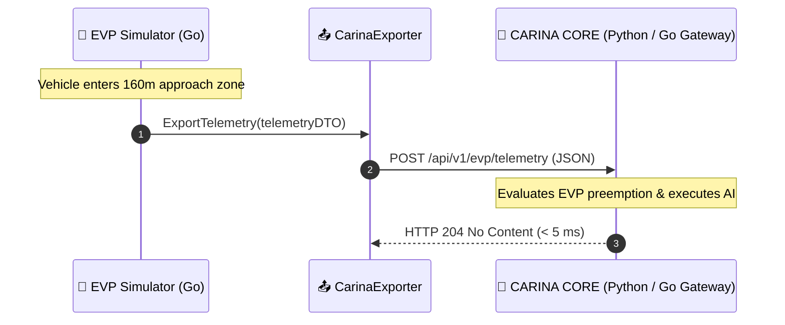

# 📡 CARINA CORE Integration & Real-Time Telemetry

This document describes the telemetry dispatch pipeline connecting **EVP Simulator** with the **CARINA CORE** adaptive traffic network AI, implemented in `internal/infrastructure/httpclient/carina_exporter.go`.

⬅️ [Documentation Hub](README.md) | 🏛️ [Architecture](architecture.md) | 🚨 [EVP Walkthrough](evp_walkthrough.md) | 🔌 [SNMP Emulation](utmc_and_snmp_emulation.md)

---

## 1. Unidirectional Fire-and-Forget Architecture

Emulating real-world cellular GPS vehicle antennas, communication is asynchronous and non-blocking:



- **Default Endpoint:** `POST http://localhost:8085/api/v1/evp/telemetry`
- **Expected Status:** `204 No Content`
- **Strict Timeout:** $200\text{ ms}$

---

## 2. Telemetry JSON Payload Specification

```json
{
  "vehicle_id": "SAMU_UTI_01",
  "corporation": "SAMU",
  "latitude": -23.310284,
  "longitude": -51.162781,
  "speed_kmh": 64.8,
  "bearing": 182.5,
  "siren_active": true,
  "current_edge": "E_AV_BRASIL_02",
  "target_intersection": "J_CENTRO_04",
  "preemption_active": true,
  "timestamp": 1729188000123
}
```

---

<div align="center">
  <br/>
  <b>Noxfort Systems</b> — <i>A State Of Art Company</i><br/>
  <i>Intelligent Mobility Engineering • EVP Simulator v1.0.0</i>
  <small>SPDX-License-Identifier: <a href="../LICENSE">Apache-2.0</a> • &copy; 2026 Noxfort Systems</small>
</div>
