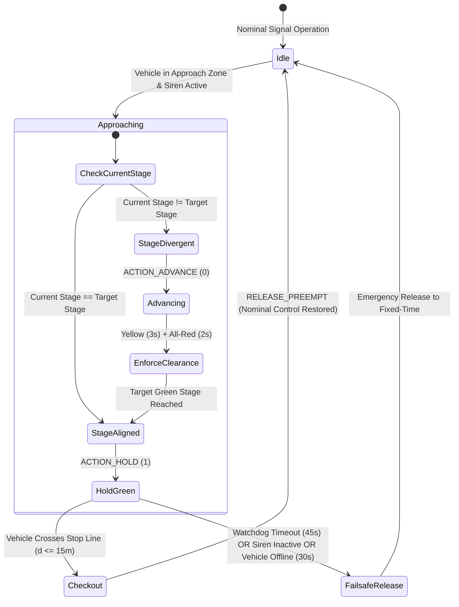

# 🚨 Emergency Vehicle Preemption (EVP) & Remote Operations Architecture

This document specifies the technical architecture of CARINA's **Emergency Vehicle Preemption (EVP)** subsystem located in [`src/evp/`](../../src/evp), the high-speed Go preemption dispatcher in [`src_go/evp_go/`](../../src_go/evp_go), the **Web Gateway with Tailscale Mesh Networking** in [`src_go/web_gateway/`](../../src_go/web_gateway), and the **Central Control Operator (CCO) Web Map Interface** in [`src_tsx/src_cco/`](../../src_tsx/src_cco).

⬅️ Back to [Main Documentation Hub](carina_moc.md) | 🏛️ See [System Architecture](architecture.md) | 🛡️ See [Safety & Watchdog](safety_and_watchdog.md) | 🚦 See [Hardware Drivers](hardware_drivers.md)

---

## 1. Overview & Regulatory Framework

The Emergency Vehicle Preemption (EVP) subsystem grants deterministic, real-time right-of-way (Green Corridors) to active emergency response vehicles—including **SAMU** (Mobile Emergency Medical Services), **Fire Department** (Corpo de Bombeiros), and **Police Forces** (Polícia Militar / Civil / Rodoviária).

CARINA's EVP engine adheres strictly to both Brazilian traffic safety regulations (**CONTRAN Resolution nº 960** and **Art. 29, Section VII of the Brazilian Traffic Code - CTB**) and international ITS specifications (**FHWA MUTCD Section 4D.26**):

1. **Constitutional Right-of-Way with Regulated Safety (Art. 29 CTB):** Emergency priority requires simultaneous auditory and visual warning systems (active siren and emergency beacons). Even under preemption, transition clearance intervals (yellow and all-red) are strictly enforced to protect conflicting traffic and pedestrians.
2. **Deterministic Two-Factor Trigger:** Preemption is only requested when an authorized vehicle is both **spatially positioned within the target approach block** ($60\text{ m} \le d \le 160\text{ m}$ or actual network block length) **AND** has its **auditory siren actively engaged** (`siren_active = True`).
3. **Immediate Checkout Clearance:** Once the emergency vehicle crosses the intersection stop line ($d \le 15\text{ m}$ into the intersection), preemption is released immediately without lingering green phase waste.
4. **Autonomous Watchdog Fail-Safe:** An unconditional 45-second maximum preemption dwell timer prevents arterial deadlock if an emergency vehicle stops, turns off its siren, or crashes.

---

## 2. High-Level Subsystem Architecture

```mermaid
graph TD
    subgraph Vehicle Fleet
        GPS[Emergency GPS Antenna / Mobile App] -->|HTTP POST 204 Fire-and-Forget| WebGW[Go Web Gateway port 2201 / 8085]
    end

    subgraph Go Gateway Layer (src_go)
        WebGW --> TS[Tailscale Funnel / VPN Mesh]
        WebGW --> SSE[SSE Broadcast Hub /cco/stream]
        WebGW --> EVP_Go[evp_go Dispatcher]
        WebGW -->|IPC Pipe Line JSON| GoClient[GoGatewayClient Python Proxy]
    end

    subgraph CARINA Core Engine (src/evp)
        GoClient --> EVPSvc[EVPService Singleton]
        EVPSvc --> FleetMgr[EVPFleetManager & Repositories]
        EVPSvc --> Kinematics[EVPKinematicsEngine Haversine WGS84]
        EVPSvc --> PreemptEng[EVPPreemptionEngine State Machine]
        EVPSvc --> TopoSvc[EVPTopologyService Dynamic Blocks]
    end

    subgraph Neuro-Symbolic Safety Firewall
        PreemptEng -->|Rule #0 Priority Intercept| Auditor[SafetyAuditor Core]
        Auditor -->|Enforce Yellow & All-Red| TransitionMgr[StageTransitionManager]
        TransitionMgr -->|Dispatches HOLD or ADVANCE| HardwareMgr[Physical Controllers NTCIP/UTMC]
    end

    subgraph Operator Dashboards
        SSE --> CCO[CCO Web Map React/TSX src_tsx]
        EVPSvc -->|In-Memory Event Bus| FletUI[Flet Desktop UI ui/cards/ & ui/widgets/]
    end
```

---

## 3. Domain Model & Entities (`src/evp/evp_models.py`)

The EVP domain model encapsulates vehicle identification, municipal fleet authorization, and kinematic telemetry:

### 3.1 Corporation Classification (`CorporationType`)

| Corporation | Code | UI Canvas Shape | Nominal Color | Siren Alert Color | Conflict Priority |
| :--- | :---: | :---: | :---: | :---: | :---: |
| **SAMU (Ambulance)** | `SAMU` | Triangle ($\Delta$) | White (`#FFFFFF`) | Vivid Red (`#E53935`) | Priority 1 (Life Safety) |
| **Fire Department** | `BOMBEIRO` | Square ($\square$) | Amber (`#FF8C00`) | Fire Orange (`#FF3D00`) | Priority 1 (Life Safety) |
| **Police (Civil / PM)** | `POLICIA` | Circle ($\bigcirc$) | Dark Blue (`#1E3A8A`) | Royal Blue (`#2563EB`) | Priority 2 (Public Order) |

### 3.2 Registered Fleet Entity (`RegisteredVehicle`)
Represents a municipal vehicle officially credentialed to interface with CARINA:
- `vehicle_id` (e.g., `"SAMU-01"`): Unique alphanumeric fleet unit code.
- `corporation`: Target `CorporationType`.
- `plate`: Legal vehicle license plate.
- `ip_address` / `port`: Hardware communication parameters for onboard transponders.
- `auth_token`: Optional cryptographic token verifying ingestion payload authenticity.
- `is_active`: Administrative authorization toggle.

### 3.3 Dynamic Aggregate Root (`EmergencyVehicle`)
Encapsulates real-time telemetry, spatial state, and the active preemption lifecycle:
- Geolocation: `latitude`, `longitude`, `speed_kmh`, `heading_deg`.
- Operation mode: `siren_active` (boolean).
- Preemption state: `is_evp_triggered`, `active_intersection_id`, `active_intersections` (set), `dwell_start_time`.
- Connection liveness: `is_online` evaluated against `offline_timeout_seconds` (default: $30.0\text{ s}$).

---

## 4. Geodesic Kinematics & Spatial Detection (`src/evp/evp_kinematics.py`)

Geodesic distances are computed using the **Haversine Formula** over the WGS84 Earth ellipsoid ($R = 6,371,000\text{ m}$):

$$\Delta\phi = \text{radians}(\phi_2 - \phi_1), \quad \Delta\lambda = \text{radians}(\lambda_2 - \lambda_1)$$

$$a = \sin^2\left(\frac{\Delta\phi}{2}\right) + \cos(\phi_1)\cos(\phi_2)\sin^2\left(\frac{\Delta\lambda}{2}\right)$$

$$c = 2 \cdot \text{atan2}\left(\sqrt{a}, \sqrt{1 - a}\right), \quad d = R \cdot c$$

```text
 Approach Block Entry Gate                          Intersection Stop Line
  (60m <= d <= 160m)                                  (Checkout: d <= 15m)
─────────┬─────────────────────────────────────────────────────┬─────────►
         │ <────────────── Approach Zone ────────────────────> │
   Vehicle Enters                                        Vehicle Crosses
   Preemption Triggered                                  Preemption Released
   (if siren_active=True)                                (Immediate Nominal Return)
```

### 4.1 Block Entry Trigger (`is_at_block_entrance`)
- Evaluates whether distance to intersection satisfies:
  
  $$d_{\text{min}} \le d_{\text{vehicle}} \le d_{\text{max}}$$
  
  Where $d_{\text{min}} = 60.0\text{ m}$ and $d_{\text{max}} = 160.0\text{ m}$ (or the actual topological road segment length $L_{\text{quadra}}$ derived from [`EVPTopologyService`](../../src/evp/evp_topology_service.py)).

### 4.2 Checkout Detection (`has_checked_out`)
- When $d_{\text{vehicle}} \le 15.0\text{ m}$ and trajectory transitions beyond the stop line, the preemption engine executes an atomic checkout, clearing the intersection hold.

---

## 5. Preemption State Machine & Lifecycle (`src/evp/evp_preemption_engine.py`)

The preemption state machine coordinates signal stage transitions without violating regulatory intergreen clearances:



### 5.1 Preemption Actions
- **`ACTION_HOLD` (1):** Held when the current physical stage matches the emergency corridor phase (`target_stage`). Prevents the local controller from terminating green until the vehicle checks out.
- **`ACTION_ADVANCE` (0):** Issued when the controller is in a conflicting stage. Requests immediate phase advance through mandatory yellow and all-red clearance intervals.

### 5.2 Regulatory Watchdog & Failsafe Timers
1. **CONTRAN Max Dwell Timeout ($45.0\text{ s}$):** If preemption remains active for more than $45\text{ s}$ on a single junction, it is terminated unconditionally to clear accumulated cross-traffic queues.
2. **Vehicle Offline Timeout ($30.0\text{ s}$):** If telemetry updates cease for $> 30\text{ s}$, the vehicle is marked offline and preemption is aborted.
3. **Siren Deactivation:** If the driver turns off the siren (`siren_active = False`), the green corridor disarms instantly.

---

## 6. Integration with Core Safety Auditor (`SafetyAuditor`)

In [`src/core/safety_auditor.py`](../../src/core/safety_auditor.py), EVP preemption is processed as **Rule #0 (Emergency Priority Interception)** before evaluating conventional neural proposals or symbolic rules SR-01 through SR-05:

```python
# 0. Emergency Priority Interception (EVP - Emergency Vehicle Preemption)
try:
    from src.evp.evp_bridge import EVPBridge
    bridge = EVPBridge()
    evp_action, is_evp, _ = bridge.intercept_safety_audit(
        tl_id=tl_id,
        current_stage=current_stage_idx,
        stage_duration=current_stage_duration,
        suggested_action=suggested_action,
    )
    if is_evp and evp_action is not None:
        if evp_action == 1:
            self.last_veto_reasons[tl_id] = "Preempção de Veículo de Emergência (EVP - Corredor Verde Ativo)"
        return evp_action, (evp_action == 1)
except Exception:
    pass
```

---

## 7. High-Performance Hardware Dispatcher (`src_go/evp_go/`)

The compiled Go binary (`bin/carina-go`) handles microsecond execution of preemption holds over NTCIP 1202 and UTMC2 controllers:

### 7.1 Dispatcher Command Routing (`dispatcher.go`)
- Receives `PreemptionCommand` envelopes from the gateway router.
- `activate_preempt`: Injects physical `ascPhaseHold` OID bitmasks via SNMP on UDP port 161.
- `release_preempt`: Clears phase hold bitmasks, returning control to local actuation or nominal cycle timers.

---

## 8. Web Gateway & Remote Connectivity (`src_go/web_gateway/`)

The Go Web Gateway hosts external endpoints for vehicle telematics and browser-based traffic operations:

```text
                  TAILSCALE FUNNEL (Port 2201 / HTTPS)
                    (Secure Public/Private Access)
                                │
               ┌────────────────┴────────────────┐
               ▼                                 ▼
      /api/v1/evp/telemetry                  /cco/stream
   (Vehicle GPS Antennas)             (Browser Videowalls)
   - HTTP POST (Fire-and-Forget)      - Server-Sent Events (SSE)
   - HTTP 204 No Content              - Live JSON Telemetry Frames
```

### 8.1 Unidirectional GPS Ingestion (`handlers_evp.go`)
- **Route:** `POST /api/v1/evp/telemetry` (and `/amb`)
- **Status Response:** `204 No Content`
- **Ingestion Latency:** $< 0.5\text{ ms}$
- **Payload Schema:**
  ```json
  {
    "vehicle_id": "SAMU-01",
    "corporation": "SAMU",
    "latitude": -23.31028,
    "longitude": -51.16278,
    "speed_kmh": 68.5,
    "heading_deg": 182.0,
    "siren_active": true,
    "timestamp": 1789458600.0
  }
  ```

### 8.2 Tailscale Funnel Integration (`tailscale.go`)
- Enables zero-configuration encrypted tunnels directly from the edge gateway without opening public inbound router ports.
- Automatically queries node machine status via local Tailscale IPC sockets to dynamically populate public CCO URLs.

---

## 9. Central Control Operator (CCO) Web Interface (`src_tsx/src_cco/`)

A high-density operational videowall built with **React 18**, **TypeScript**, **Tailwind CSS**, and **ECharts**:

- **Real-Time SSE Subscription:** [`SseCcoStreamService.ts`](../../src_tsx/src_cco/infrastructure/stream/SseCcoStreamService.ts) connects to `/cco/stream`, consuming incoming frames without polling.
- **SVG Map Layers:**
  - `MapRoadsLayer.tsx`: Network road links color-coded by congestion level.
  - `MapTrafficLightsLayer.tsx`: Real-time signal phase indications.
  - `MapEmergencyVehiclesLayer.tsx`: Flashing corporation geometric markers.
- **Alert Notifications:** [`EvpAlertToast.tsx`](../../src_tsx/src_cco/presentation/components/EvpAlertToast.tsx) triggers HUD banners whenever an active preemption corridor is initiated.
- **Vehicle Inspector:** [`VehicleInspectionCard.tsx`](../../src_tsx/src_cco/presentation/components/map/VehicleInspectionCard.tsx) provides instant speed, heading, and preemption diagnostics upon clicking a vehicle marker.

---

## 10. Desktop Flet UI Integration (`ui/`)

CARINA's native Flet desktop GUI includes dedicated preemption components:

### 10.1 Settings Cards (`ui/cards/`)
- **`EVPFleetConnectionCard` (`evp_fleet_connection_card.py`):**
  - Live table of registered emergency vehicles.
  - CSV Import/Export tool for municipal fleet credential provisioning.
  - Status indicators (Active / Inactive, Online / Offline).
- **`EVPSafetyParametersCard` (`evp_safety_parameters_card.py`):**
  - Configuration of approach block entry distance ($60\text{--}160\text{ m}$).
  - Maximum preemption dwell watchdog limit ($15\text{--}120\text{ s}$).
  - Unregistered fleet auto-registration toggle.

### 10.2 Canvas Widgets (`ui/widgets/`)
- **`EVPVehicleMarker` (`evp_vehicle_marker.py`):** Vector rendering on the live canvas with pulsing animations driven by [`MapAnimator`](../../ui/animators/map_animator.py).
- **`EVPVehicleCard` (`evp_vehicle_card.py`):** Floating telemetry inspection card.

---

## 11. Relational Database Schemas

All vehicle registrations and telemetry transactions are persisted in PostgreSQL / SQLite:

### 11.1 Table: `evp_registered_fleet`
```sql
CREATE TABLE IF NOT EXISTS evp_registered_fleet (
    vehicle_id VARCHAR(64) PRIMARY KEY,
    corporation VARCHAR(32) NOT NULL,
    plate VARCHAR(16),
    description VARCHAR(128),
    device_id VARCHAR(64),
    ip_address VARCHAR(45),
    port INT DEFAULT 8085,
    protocol VARCHAR(16) DEFAULT 'HTTP',
    auth_token VARCHAR(128),
    is_active BOOLEAN DEFAULT TRUE,
    created_at TIMESTAMP DEFAULT CURRENT_TIMESTAMP
);
```

### 11.2 Table: `evp_telemetry_records`
```sql
CREATE TABLE IF NOT EXISTS evp_telemetry_records (
    id BIGSERIAL PRIMARY KEY,
    vehicle_id VARCHAR(64) NOT NULL,
    corporation VARCHAR(32) NOT NULL,
    latitude DOUBLE PRECISION NOT NULL,
    longitude DOUBLE PRECISION NOT NULL,
    speed_kmh REAL NOT NULL,
    heading_deg REAL NOT NULL,
    siren_active BOOLEAN NOT NULL,
    evp_triggered BOOLEAN NOT NULL DEFAULT FALSE,
    intersection_id VARCHAR(64),
    created_at TIMESTAMP DEFAULT CURRENT_TIMESTAMP
);

CREATE INDEX idx_evp_veh_time ON evp_telemetry_records (vehicle_id, created_at DESC);
```

### 11.3 Table: `evp_denied_fleet`
```sql
CREATE TABLE IF NOT EXISTS evp_denied_fleet (
    vehicle_id VARCHAR(64) PRIMARY KEY,
    denied_at TIMESTAMP DEFAULT CURRENT_TIMESTAMP
);
```

---

## 12. Verification & Testing

### 12.1 Automated Pytest Suite
The EVP subsystem is backed by 12 comprehensive unit test modules in `tests/unit/`:
```bash
pytest tests/unit/test_evp_*.py -v
```

Key test modules include:
- `test_evp_service.py`: Two-factor trigger, CONTRAN action evaluation, lifecycle transitions.
- `test_evp_kinematics.py`: Geodesic distance, entry gate thresholds, checkout boundaries.
- `test_evp_preemption_engine.py`: Green corridor hold, watchdog expiration, failsafe release.
- `test_evp_fleet_persistence.py` & `test_evp_fleet_csv.py`: Database CRUD and CSV synchronization.

### 12.2 Standalone Simulation CLI (`demo/evp_vehicle_simulator.py`)
To simulate real-world emergency runs against a live CARINA instance:
```bash
# Emergency run mode with active siren (SAMU-01)
python demo/evp_vehicle_simulator.py --vehicle SAMU-01 --mode emergency

# Patrol mode across fleet (SAMU, Firefighters, Police)
python demo/evp_vehicle_simulator.py --mode patrol --duration 60
```

---

<div align="center">
  <br/>
  <b>Noxfort Systems</b> — <i>A State Of Art Company</i><br/>
  <i>Intelligent Mobility Engineering • CARINA CORE v1.2.0</i><br/>
  <small>© 2026 Noxfort Systems. Licensed under AGPLv3.</small>
</div>
