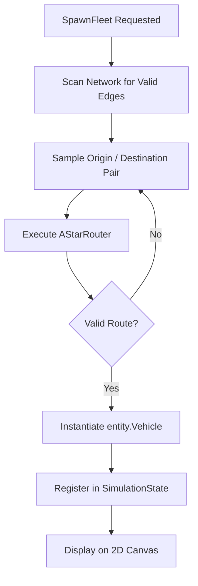

# 🚑 Emergency Fleet Management & `FleetSpawner`

This document covers emergency fleet modeling and procedural route generation in `internal/domain/service/fleet_spawner.go` and `internal/domain/entity/vehicle.go`.

⬅️ [Documentation Hub](README.md) | 🏛️ [Architecture](architecture.md) | 🚗 [Kinematics](kinematics_and_routing.md) | 📊 [CSV Exchanger](csv_data_exchanger.md)

---

## 1. Supported Corporation Typology

| Corporation | Vehicle Role | Max Acceleration | Top Speed | Visual Color |
| :--- | :--- | :---: | :---: | :---: |
| **SAMU** | Ambulance / Mobile ICU | $3.0\text{ m/s}^2$ | $80\text{ km/h}$ | 🟡 Amber / 🔴 Red |
| **BOMBEIROS** | Heavy Fire Engine / Rescue | $2.2\text{ m/s}^2$ | $70\text{ km/h}$ | 🔴 Crimson Red |
| **POLICIA_MILITAR** | Tactical Patrol Cruiser | $3.8\text{ m/s}^2$ | $90\text{ km/h}$ | 🔵 Cobalt Blue |
| **POLICIA_CIVIL** | Unmarked Investigation Unit | $3.5\text{ m/s}^2$ | $85\text{ km/h}$ | ⚫ Dark Slate |

---

## 2. Procedural Mission & Route Generation

`FleetSpawner` leverages `AStarRouter` to generate realistic urban mission paths:

---

   
  <b>Noxfort Systems</b> — <i>A State Of Art Company</i> 
  <i>Intelligent Mobility Engineering • EVP Simulator v1.0.0</i>
  <small>SPDX-License-Identifier: <a href="../../LICENSE">Apache-2.0</a> • &copy; 2026 Noxfort Systems</small>

