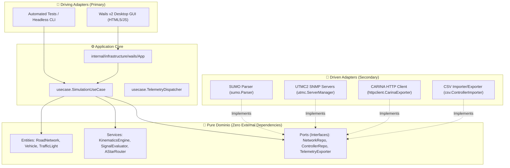
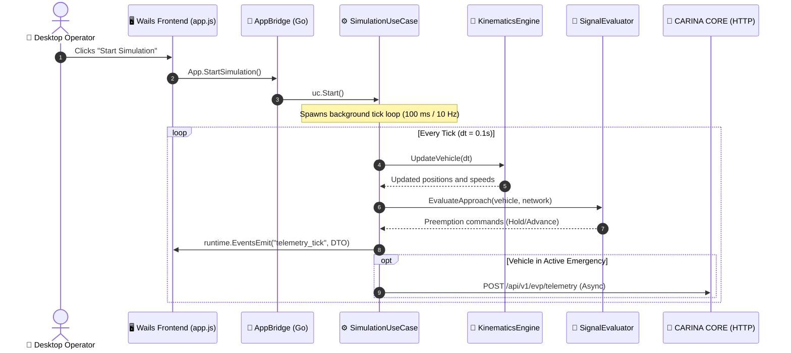

# 🏛️ Arquitectura del Sistema Go y Modelo de Concurrencia

This document details the engineering principles of the **EVP Simulator**. Built in **Go 1.22**, the application strictly adheres to **Clean Architecture**, **Dominio-Driven Design (DDD)**, and **Hexagonal Architecture (Ports & Adapters)**, ensuring complete decoupling between traffic kinematic logic, UI rendering, and external communication protocols.

⬅️ [Centro de Documentación](README.md) | 🗺️ [Master MOC](evp_moc.md) | 🚨 [EVP Walkthrough](evp_walkthrough.md) | ⚡ [Wails Bridge](wails_ipc_and_bridges.md)

---

## 1. Hexagonal Architecture Principles

The core simulation engine has zero external dependencies on graphical frameworks, databases, or networking libraries:

---

## 2. Concurrency Model & Simulation Lifecycle

Simulation execution progresses in discrete time steps (*ticks*) inside a dedicated goroutine decoupled from the GUI rendering thread:

### 2.1 State Protection & Thread Safety
The shared simulation state (`SimulationState`) is protected by a read/write mutex (`sync.RWMutex`):
- Projections for UI rendering and CSV logging acquire `RLock()`, enabling concurrent access without UI latency spikes.
- Tick progression, fleet spawning, and scenario reset acquire `Lock()`, ensuring atomic state mutation and eliminating data races.

---

## 3. Non-Blocking Network I/O Decoupling

To prevent external network latency from stalling the 60 FPS UI rendering or the 10 Hz physics step, `TelemetryDispatcher` uses a bounded asynchronous queue:
- Telemetry events are enqueued into a buffered channel of 1,000 items.
- A dedicated background worker routine consumes frames and executes HTTP calls.
- If network congestion occurs, non-critical frames are discarded with rate-limited warning logs (*load shedding*), preserving simulation determinism.

---

   
  <b>Noxfort Systems</b> — <i>A State Of Art Company</i> 
  <i>Ingeniería de Movilidad Inteligente • EVP Simulator v1.0.0</i>
  <small>SPDX-License-Identifier: <a href="../../LICENSE">Apache-2.0</a> • &copy; 2026 Noxfort Systems</small>

