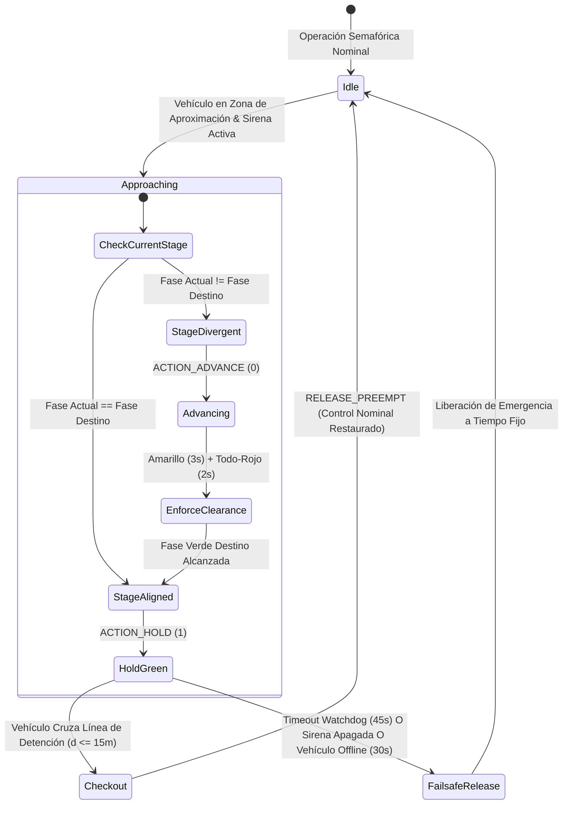

# 🚨 Arquitectura de Preempción de Vehículos de Emergencia (EVP) y Operaciones Remotas

Este documento especifica la arquitectura técnica del subsistema de **Preempción de Vehículos de Emergencia (EVP)** de CARINA ubicado en [`src/evp/`](../../src/evp), el despachador de preempción en Go de alta velocidad en [`src_go/evp_go/`](../../src_go/evp_go), el **Gateway Web con Red en Malla Tailscale** en [`src_go/web_gateway/`](../../src_go/web_gateway) y la **Interfaz Web de Videowall CCO (Centro de Control Operativo)** en [`src_tsx/src_cco/`](../../src_tsx/src_cco).

⬅️ Volver al [Portal Central MOC](carina_moc.md) | 🏛️ Ver [Arquitectura del Sistema](architecture.md) | 🛡️ Ver [Seguridad y Watchdog](safety_and_watchdog.md) | 🚦 Ver [Controladores de Hardware](hardware_drivers.md)

---

## 1. Visión General y Marco Regulatorio

El subsistema de Preempción de Vehículos de Emergencia (EVP) concede derecho de paso determinista en tiempo real (**Corredores Verdes**) a vehículos de auxilio en servicio urgente — incluyendo **SAMU** (Servicio de Atención Médica de Urgencia / Ambulancias), **Cuerpo de Bomberos** y **Fuerzas Policiales** (Policía Militar, Civil y de Tránsito).

El motor de EVP de CARINA cumple rigurosamente con las normativas internacionales de tránsito y regulaciones de ITS (**Resolución CONTRAN nº 960**, **Art. 29, Inciso VII del CTB** y **FHWA MUTCD Sección 4D.26**):

1. **Prioridad Constitucional con Seguridad Reglamentada:** La prioridad de paso exige el uso simultáneo de señales sonoras y luminosas de advertencia (sirena activa y luces de emergencia/estroboscópicas). Incluso bajo preempción, los intervalos de seguridad de transición (tiempos de amarillo y rojo de despeje/*all-red*) se cumplen obligatoriamente para salvaguardar a peatones y vehículos que ya han ingresado a la intersección.
2. **Disparador Determinista de Dos Factores (*Two-Factor Trigger*):** La preempción solo se solicita cuando el vehículo credenciado se encuentra **simultáneamente dentro de la compuerta espacial de aproximación** ($60\text{ m} \le d \le 160\text{ m}$ o la longitud real del tramo vial de la red) **Y** con la **sirena acústica de emergencia encendida** (`siren_active = True`).
3. **Liberación Inmediata de Salida (*Checkout Clearance*):** Tan pronto como la unidad cruza la línea de detención del semáforo ($d \le 15\text{ m}$ dentro de la intersección), la orden de preempción se cancela instantáneamente, evitando desperdicios de tiempo verde en la arteria transversal.
4. **Watchdog Autónomo contra Bloqueos:** Un temporizador watchdog incondicional con límite máximo de permanencia (*dwell*) de 45 segundos cancela el corredor verde en caso de que la unidad se detenga, apague la sirena o sufra un percance durante la aproximación, impidiendo el colapso vial perpetuo en arterias cruzadas.

---

## 2. Arquitectura de Alto Nivel del Subsistema

```mermaid
graph TD
    subgraph Flota de Vehículos
        GPS[Antena GPS / App Móvil] -->|HTTP POST 204 Fire-and-Forget| WebGW[Go Web Gateway puerto 2201 / 8085]
    end

    subgraph Capa Go Gateway (src_go)
        WebGW --> TS[Tailscale Funnel / VPN Mesh]
        WebGW --> SSE[Hub de Transmisión SSE /cco/stream]
        WebGW --> EVP_Go[evp_go Dispatcher]
        WebGW -->|IPC Pipe Line JSON| GoClient[GoGatewayClient Python Proxy]
    end

    subgraph Núcleo CARINA (src/evp)
        GoClient --> EVPSvc[EVPService Singleton]
        EVPSvc --> FleetMgr[EVPFleetManager & Repositorios]
        EVPSvc --> Kinematics[EVPKinematicsEngine Haversine WGS84]
        EVPSvc --> PreemptEng[EVPPreemptionEngine Máquina de Estados]
        EVPSvc --> TopoSvc[EVPTopologyService Cuadras Dinámicas]
    end

    subgraph Firewall Neuro-Simbólico de Seguridad
        PreemptEng -->|Interceptación Prioritaria Regla 0| Auditor[SafetyAuditor Core]
        Auditor -->|Garantiza Amarillo & Rojo Total| TransitionMgr[StageTransitionManager]
        TransitionMgr -->|Despacha HOLD o ADVANCE| HardwareMgr[Controladores Físicos NTCIP/UTMC]
    end

    subgraph Paneles de Operación
        SSE --> CCO[CCO Web Map React/TSX src_tsx]
        EVPSvc -->|Bus en Memoria| FletUI[Interfaz Flet Desktop ui/cards/ & ui/widgets/]
    end
```

---

## 3. Modelo de Dominio y Entidades (`src/evp/evp_models.py`)

El modelo de dominio EVP encapsula la identificación del vehículo, la autorización municipal de la flota y la telemetría cinemática:

### 3.1 Clasificación de Corporaciones (`CorporationType`)

| Corporación | Código | Forma Canvas UI | Color Nominal | Color Alerta Sirena | Prioridad de Conflicto |
| :--- | :---: | :---: | :---: | :---: | :---: |
| **SAMU (Ambulancia)** | `SAMU` | Triángulo ($\Delta$) | Blanco (`#FFFFFF`) | Rojo Vivo (`#E53935`) | Prioridad 1 (Protección de Vida) |
| **Cuerpo de Bomberos** | `BOMBEIRO` | Cuadrado ($\square$) | Ámbar (`#FF8C00`) | Naranja Fuego (`#FF3D00`) | Prioridad 1 (Protección de Vida) |
| **Policía (Civil / PM / Tránsito)** | `POLICIA` | Círculo ($\bigcirc$) | Azul Oscuro (`#1E3A8A`) | Azul Real (`#2563EB`) | Prioridad 2 (Orden Público) |

### 3.2 Entidad de Flota Registrada (`RegisteredVehicle`)
Representa un vehículo municipal oficialmente habilitado para operar con CARINA:
- `vehicle_id` (ej., `"SAMU-01"`): Código alfanumérico único de la unidad de la flota.
- `corporation`: Tipo de corporación de destino `CorporationType`.
- `plate`: Matrícula / placa legal del vehículo.
- `ip_address` / `port`: Parámetros de comunicación de red para transpondedores a bordo.
- `auth_token`: Token criptográfico opcional para verificar la autenticidad del payload de ingestión.
- `is_active`: Conmutador administrativo de autorización.

### 3.3 Raíz de Agregado Dinámica (`EmergencyVehicle`)
Encapsula la telemetría en tiempo real, el estado espacial y el ciclo de vida de preempción activa:
- Geolocalización: `latitude`, `longitude`, `speed_kmh`, `heading_deg`.
- Modo de operación: `siren_active` (booleano).
- Estado de preempción: `is_evp_triggered`, `active_intersection_id`, `active_intersections` (conjunto), `dwell_start_time`.
- Conectividad y vitalidad: `is_online` evaluado frente a `offline_timeout_seconds` (valor predeterminado: $30.0\text{ s}$).

---

## 4. Cinemática Geodésica y Detección Espacial (`src/evp/evp_kinematics.py`)

Las distancias geodésicas se calculan utilizando la **Fórmula del Semiverseno (Haversine)** sobre el elipsoide terrestre WGS84 ($R = 6,371,000\text{ m}$):

$$\Delta\phi = \text{radianes}(\phi_2 - \phi_1), \quad \Delta\lambda = \text{radianes}(\lambda_2 - \lambda_1)$$

$$a = \sin^2\left(\frac{\Delta\phi}{2}\right) + \cos(\phi_1)\cos(\phi_2)\sin^2\left(\frac{\Delta\lambda}{2}\right)$$

$$c = 2 \cdot \text{atan2}\left(\sqrt{a}, \sqrt{1 - a}\right), \quad d = R \cdot c$$

```text
 Compuerta de Entrada al Bloque de Aproximación            Línea de Detención
  (60m <= d <= 160m)                                     (Salida/Checkout: d <= 15m)
─────────┬─────────────────────────────────────────────────────┬─────────►
         │ <────────────── Zona de Aproximación ─────────────> │
   Vehículo Entra                                        Vehículo Cruza
   Preempción Activada                                   Preempción Liberada
   (si siren_active=True)                                (Retorno Inmediato a Nominal)
```

### 4.1 Disparador de Entrada al Bloque (`is_at_block_entrance`)
- Evalúa si la distancia hacia la intersección satisface:
  
  $$d_{\text{min}} \le d_{\text{vehículo}} \le d_{\text{max}}$$
  
  Donde $d_{\text{min}} = 60.0\text{ m}$ y $d_{\text{max}} = 160.0\text{ m}$ (o la longitud real del segmento topológico vial $L_{\text{cuadra}}$ provista por [`EVPTopologyService`](../../src/evp/evp_topology_service.py)).

### 4.2 Detección de Salida / Checkout (`has_checked_out`)
- Cuando $d_{\text{vehículo}} \le 15.0\text{ m}$ y la trayectoria transiciona más allá de la línea de detención, el motor de preempción ejecuta un checkout atómico, cancelando de inmediato la retención en la intersección.

---

## 5. Máquina de Estados de Preempción y Ciclo de Vida (`src/evp/evp_preemption_engine.py`)

La máquina de estados de preempción coordina las transiciones de fases semafóricas sin vulnerar los despejes reglamentarios entre verdes (*intergreen*):



### 5.1 Acciones de Preempción
- **`ACTION_HOLD` (1):** Se mantiene cuando la fase física actual coincide con la fase del corredor de emergencia (`target_stage`). Evita que el controlador local finalice el verde hasta que la unidad realice el checkout.
- **`ACTION_ADVANCE` (0):** Se emite cuando el controlador se encuentra en una fase conflictiva. Solicita el avance inmediato de fases cumpliendo rigurosamente los intervalos obligatorios de despeje de amarillo y todo-rojo.

### 5.2 Temporizadores de Watchdog y Failsafe Regulatorios
1. **Límite Máximo de Permanencia CONTRAN ($45.0\text{ s}$):** Si la preempción permanece activa por más de $45\text{ s}$ en una misma intersección, se cancela incondicionalmente para desahogar las colas vehiculares acumuladas en la vía transversal.
2. **Timeout de Vehículo Desconectado ($30.0\text{ s}$):** Si las actualizaciones de telemetría se interrumpen por $> 30\text{ s}$, el vehículo se marca como fuera de línea y la preempción se desactiva.
3. **Desactivación de Sirena:** Si el conductor apaga la sirena (`siren_active = False`), el corredor verde se desarma instantáneamente.

---

## 6. Integración con el Safety Auditor Central (`SafetyAuditor`)

En [`src/core/safety_auditor.py`](../../src/core/safety_auditor.py), la preempción EVP se procesa como la **Regla #0 (Interceptación Prioritaria de Emergencia)** antes de evaluar las propuestas neuronales convencionales o las reglas simbólicas SR-01 a SR-05:

```python
# 0. Emergency Priority Interception (EVP - Emergency Vehicle Preemption)
try:
    from src.evp.evp_bridge import EVPBridge
    bridge = EVPBridge()
    evp_action, is_evp, _ = bridge.intercept_safety_audit(
        tl_id=tl_id,
        current_stage=current_stage_idx,
        stage_duration=current_stage_duration,
        suggested_action=suggested_action,
    )
    if is_evp and evp_action is not None:
        if evp_action == 1:
            self.last_veto_reasons[tl_id] = "Preempção de Veículo de Emergência (EVP - Corredor Verde Ativo)"
        return evp_action, (evp_action == 1)
except Exception:
    pass
```

---

## 7. Despachador de Hardware de Alto Rendimiento (`src_go/evp_go/`)

El binario compilado en Go (`bin/carina-go`) procesa la ejecución en microsegundos de las retenciones de preempción sobre controladores NTCIP 1202 y UTMC2:

### 7.1 Enrutamiento de Comandos del Despachador (`dispatcher.go`)
- Recibe los sobres de comando `PreemptionCommand` desde el enrutador del gateway.
- `activate_preempt`: Inyecta máscaras de bits OID físicas de `ascPhaseHold` vía SNMP en el puerto UDP 161.
- `release_preempt`: Borra las máscaras de bits de retención de fase, retornando el control a la actuación local o temporizadores de ciclo nominales.

---

## 8. Gateway Web y Conectividad Remota (`src_go/web_gateway/`)

El Gateway Web en Go aloja endpoints externos para la telemática de los vehículos y la operación del centro de tráfico desde navegadores:

```text
                  TAILSCALE FUNNEL (Puerto 2201 / HTTPS)
                    (Acceso Seguro Público/Privado)
                                 │
                ┌────────────────┴────────────────┐
                ▼                                 ▼
       /api/v1/evp/telemetry                  /cco/stream
    (Antenas GPS de Vehículos)          (Videowalls de Navegador)
    - HTTP POST (Fire-and-Forget)       - Server-Sent Events (SSE)
    - HTTP 204 No Content               - Tramas de Telemetría JSON en Vivo
```

### 8.1 Ingestión Unidireccional de GPS (`handlers_evp.go`)
- **Ruta:** `POST /api/v1/evp/telemetry` (y `/amb`)
- **Respuesta de Estado:** `204 No Content`
- **Latencia de Ingestión:** $< 0.5\text{ ms}$
- **Esquema del Payload:**
  ```json
  {
    "vehicle_id": "SAMU-01",
    "corporation": "SAMU",
    "latitude": -23.31028,
    "longitude": -51.16278,
    "speed_kmh": 68.5,
    "heading_deg": 182.0,
    "siren_active": true,
    "timestamp": 1789458600.0
  }
  ```

### 8.2 Integración con Tailscale Funnel (`tailscale.go`)
- Permite túneles cifrados con cero configuración directamente desde el gateway perimetral sin abrir puertos públicos entrantes en el enrutador físico.
- Consulta de forma automática el estado de la máquina nodo vía sockets IPC locales de Tailscale para poblar dinámicamente las URLs públicas del CCO.

---

## 9. Interfaz Web del Operador del Centro de Control (CCO) (`src_tsx/src_cco/`)

Un videowall operacional de alta densidad construido con **React 18**, **TypeScript**, **Tailwind CSS** y **Apache ECharts**:

- **Suscripción SSE en Tiempo Real:** [`SseCcoStreamService.ts`](../../src_tsx/src_cco/infrastructure/stream/SseCcoStreamService.ts) se conecta a `/cco/stream`, consumiendo las tramas entrantes sin sobrecarga de sondeo (polling).
- **Capas de Mapa SVG:**
  - `MapRoadsLayer.tsx`: Enlaces de la red vial codificados por colores según el nivel de congestión.
  - `MapTrafficLightsLayer.tsx`: Indicaciones semafóricas de fase en tiempo real.
  - `MapEmergencyVehiclesLayer.tsx`: Marcadores geométricos intermitentes de cada corporación.
- **Notificaciones de Alerta:** [`EvpAlertToast.tsx`](../../src_tsx/src_cco/presentation/components/EvpAlertToast.tsx) despliega banners emergentes en el HUD cada vez que se inicia un corredor verde activo.
- **Inspector de Vehículos:** [`VehicleInspectionCard.tsx`](../../src_tsx/src_cco/presentation/components/map/VehicleInspectionCard.tsx) ofrece diagnósticos instantáneos de velocidad, rumbo y estado de preempción al hacer clic sobre cualquier marcador vehicular.

---

## 10. Integración con la Interfaz Desktop Flet (`ui/`)

La interfaz gráfica nativa de escritorio en Flet de CARINA incluye componentes dedicados de preempción:

### 10.1 Tarjetas de Ajustes (`ui/cards/`)
- **`EVPFleetConnectionCard` (`evp_fleet_connection_card.py`):**
  - Tabla en vivo de vehículos de emergencia registrados.
  - Herramienta de importación/exportación CSV para provisión de credenciales de flota municipal.
  - Indicadores de estado (Activo / Inactivo, Online / Offline).
- **`EVPSafetyParametersCard` (`evp_safety_parameters_card.py`):**
  - Configuración de la distancia de entrada a la compuerta de aproximación ($60\text{--}160\text{ m}$).
  - Límite máximo del watchdog de permanencia de preempción ($15\text{--}120\text{ s}$).
  - Conmutador de auto-registro para unidades de flota no empadronadas.

### 10.2 Widgets de Canvas (`ui/widgets/`)
- **`EVPVehicleMarker` (`evp_vehicle_marker.py`):** Renderizado vectorial en el canvas en vivo con animaciones de pulsación impulsadas por [`MapAnimator`](../../ui/animators/map_animator.py).
- **`EVPVehicleCard` (`evp_vehicle_card.py`):** Tarjeta flotante de inspección telemétrica.

---

## 11. Esquemas de Base de Datos Relacional

Todos los registros de flota y transacciones telemétricas se almacenan en PostgreSQL / SQLite:

### 11.1 Tabla: `evp_registered_fleet`
```sql
CREATE TABLE IF NOT EXISTS evp_registered_fleet (
    vehicle_id VARCHAR(64) PRIMARY KEY,
    corporation VARCHAR(32) NOT NULL,
    plate VARCHAR(16),
    description VARCHAR(128),
    device_id VARCHAR(64),
    ip_address VARCHAR(45),
    port INT DEFAULT 8085,
    protocol VARCHAR(16) DEFAULT 'HTTP',
    auth_token VARCHAR(128),
    is_active BOOLEAN DEFAULT TRUE,
    created_at TIMESTAMP DEFAULT CURRENT_TIMESTAMP
);
```

### 11.2 Tabla: `evp_telemetry_records`
```sql
CREATE TABLE IF NOT EXISTS evp_telemetry_records (
    id BIGSERIAL PRIMARY KEY,
    vehicle_id VARCHAR(64) NOT NULL,
    corporation VARCHAR(32) NOT NULL,
    latitude DOUBLE PRECISION NOT NULL,
    longitude DOUBLE PRECISION NOT NULL,
    speed_kmh REAL NOT NULL,
    heading_deg REAL NOT NULL,
    siren_active BOOLEAN NOT NULL,
    evp_triggered BOOLEAN NOT NULL DEFAULT FALSE,
    intersection_id VARCHAR(64),
    created_at TIMESTAMP DEFAULT CURRENT_TIMESTAMP
);

CREATE INDEX idx_evp_veh_time ON evp_telemetry_records (vehicle_id, created_at DESC);
```

### 11.3 Tabla: `evp_denied_fleet`
```sql
CREATE TABLE IF NOT EXISTS evp_denied_fleet (
    vehicle_id VARCHAR(64) PRIMARY KEY,
    denied_at TIMESTAMP DEFAULT CURRENT_TIMESTAMP
);
```

---

## 12. Verificación y Pruebas

### 12.1 Suite Automatizada Pytest
El subsistema EVP cuenta con 12 módulos de pruebas unitarias exhaustivas en `tests/unit/`:
```bash
pytest tests/unit/test_evp_*.py -v
```

Los módulos clave de pruebas incluyen:
- `test_evp_service.py`: Disparador de dos factores, evaluación de acciones reglamentarias y transiciones del ciclo de vida.
- `test_evp_kinematics.py`: Distancia geodésica, umbrales de compuerta de entrada y límites de checkout.
- `test_evp_preemption_engine.py`: Retención de corredor verde, expiración por watchdog y liberación failsafe.
- `test_evp_fleet_persistence.py` y `test_evp_fleet_csv.py`: Operaciones CRUD en base de datos y sincronización CSV.

### 12.2 CLI de Simulación Independiente (`demo/evp_vehicle_simulator.py`)
Para simular recorridos reales de emergencia frente a una instancia viva de CARINA:
```bash
# Modo de carrera de emergencia con sirena activa (SAMU-01)
python demo/evp_vehicle_simulator.py --vehicle SAMU-01 --mode emergency

# Modo de patrulla a través de la flota (SAMU, Bomberos, Policía)
python demo/evp_vehicle_simulator.py --mode patrol --duration 60
```

---

<div align="center">
  <br/>
  <b>Noxfort Systems</b> — <i>A State Of Art Company</i><br/>
  <i>Ingeniería de Movilidad Inteligente • CARINA CORE v1.2.0</i><br/>
  <small>© 2026 Noxfort Systems. Licenciado bajo AGPLv3.</small>
</div>
