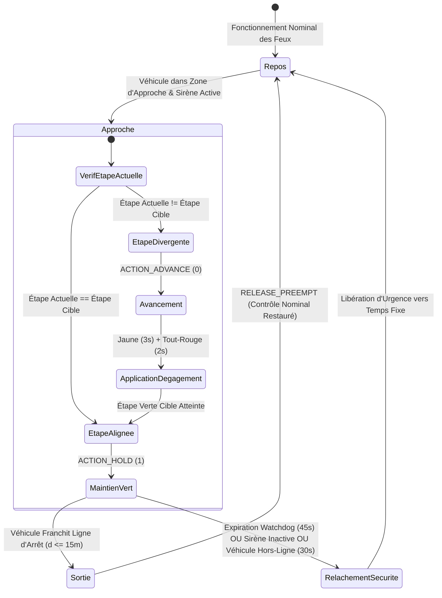

# 🚨 Préemption pour Véhicules d'Urgence (EVP) & Architecture des Opérations Distantes

Ce document spécifie l'architecture technique du sous-système de **Préemption pour Véhicules d'Urgence (EVP)** de CARINA situé dans [`src/evp/`](../../src/evp), le répartiteur de préemption Go haute vitesse dans [`src_go/evp_go/`](../../src_go/evp_go), la **Passerelle Web avec Réseau Maillé Tailscale** dans [`src_go/web_gateway/`](../../src_go/web_gateway) et l'**Interface Cartographique Web Central Control Operator (CCO)** dans [`src_tsx/src_cco/`](../../src_tsx/src_cco).

⬅️ Retour au [Hub Principal de Documentation](carina_moc.md) | 🏛️ Voir [Architecture Système](architecture.md) | 🛡️ Voir [Sécurité & Watchdog](safety_and_watchdog.md) | 🚦 Voir [Pilotes Matériels](hardware_drivers.md)

---

## 1. Vue d'Ensemble & Cadre Réglementaire

Le sous-système de Préemption pour Véhicules d'Urgence (EVP) octroie un droit de passage déterministe en temps réel (Couloirs Verts) aux véhicules d'intervention d'urgence actifs — notamment le **SAMU** (Services d'Aide Médicale Urgente), les **Sapeurs-Pompiers** (Corpo de Bombeiros) et les **Forces de Police** (Police Militaire / Civile / Routière).

Le moteur EVP de CARINA respecte strictement les réglementations brésiliennes de sécurité routière (**Résolution CONTRAN nº 960** et **Art. 29, Section VII du Code de la Route Brésilien - CTB**) ainsi que les spécifications ITS internationales (**FHWA MUTCD Section 4D.26**) :

1. **Droit de Passage Constitutionnel avec Sécurité Réglementée (Art. 29 CTB) :** La priorité d'urgence exige le fonctionnement simultané des avertisseurs sonores et lumineux (sirène active et gyrophares). Même sous préemption, les intervalles de dégagement de transition (jaune et tout-rouge) sont strictement appliqués pour protéger le trafic conflictuel et les piétons.
2. **Déclenchement Déterministe à Double Facteur :** La préemption n'est sollicitée que lorsqu'un véhicule autorisé est à la fois **positionné spatialement dans la zone d'approche cible** ($60\text{ m} \le d \le 160\text{ m}$ ou longueur réelle du tronçon routier) **ET** a son **avertisseur sonore activement enclenché** (`siren_active = True`).
3. **Libération Immédiate après Franchissement (*Checkout*) :** Dès que le véhicule d'urgence franchit la ligne d'arrêt du carrefour ($d \le 15\text{ m}$ à l'intérieur du carrefour), la préemption est immédiatement levée sans gaspillage de temps vert résiduel.
4. **Watchdog de Secours Autonome :** Un minuteur watchdog inconditionnel de maintien maximal de préemption de 45 secondes prévient les blocages artériels si un véhicule d'urgence s'arrête, coupe sa sirène ou subit un accident.

---

## 2. Architecture de Haut Niveau du Sous-Système

```mermaid
graph TD
    subgraph Flotte de Véhicules
        GPS[Antenne GPS d'Urgence / App Mobile] -->|HTTP POST 204 Envoi Direct| WebGW[Passerelle Web Go port 2201 / 8085]
    end

    subgraph Couche Passerelle Go (src_go)
        WebGW --> TS[Tailscale Funnel / VPN Mesh]
        WebGW --> SSE[Hub de Diffusion SSE /cco/stream]
        WebGW --> EVP_Go[Dispatcher evp_go]
        WebGW -->|Tube IPC Ligne JSON| GoClient[Proxy Python GoGatewayClient]
    end

    subgraph Moteur Central CARINA (src/evp)
        GoClient --> EVPSvc[Singleton EVPService]
        EVPSvc --> FleetMgr[EVPFleetManager & Dépôts]
        EVPSvc --> Kinematics[EVPKinematicsEngine Haversine WGS84]
        EVPSvc --> PreemptEng[Machine à États EVPPreemptionEngine]
        EVPSvc --> TopoSvc[Tronçons Dynamiques EVPTopologyService]
    end

    subgraph Pare-Feu de Sécurité Neuro-Symbolique
        PreemptEng -->|Interception Prioritaire Règle #0| Auditor[Cœur SafetyAuditor]
        Auditor -->|Applique Jaune & Tout-Rouge| TransitionMgr[StageTransitionManager]
        TransitionMgr -->|Expédie HOLD ou ADVANCE| HardwareMgr[Contrôleurs Physiques NTCIP/UTMC]
    end

    subgraph Tableaux de Bord Opérateurs
        SSE --> CCO[Carte Web CCO React/TSX src_tsx]
        EVPSvc -->|Bus d'Événements en Mémoire| FletUI[IHM Flet Bureau ui/cards/ & ui/widgets/]
    end
```

---

## 3. Modèle de Domaine & Entités (`src/evp/evp_models.py`)

Le modèle de domaine EVP encapsule l'identification des véhicules, l'autorisation des flottes municipales et la télémétrie cinématique :

### 3.1 Classification par Corporation (`CorporationType`)

| Corporation | Code | Forme Canvas IHM | Couleur Nominale | Couleur Alerte Sirène | Priorité de Conflit |
| :--- | :---: | :---: | :---: | :---: | :---: |
| **SAMU (Ambulance)** | `SAMU` | Triangle ($\Delta$) | Blanc (`#FFFFFF`) | Rouge Vif (`#E53935`) | Priorité 1 (Secours Vital) |
| **Sapeurs-Pompiers** | `BOMBEIRO` | Carré ($\square$) | Ambre (`#FF8C00`) | Orange Feu (`#FF3D00`) | Priorité 1 (Secours Vital) |
| **Police (Civile / PM)** | `POLICIA` | Cercle ($\bigcirc$) | Bleu Sombre (`#1E3A8A`) | Bleu Roi (`#2563EB`) | Priorité 2 (Ordre Public) |

### 3.2 Entité de Flotte Enregistrée (`RegisteredVehicle`)
Représente un véhicule municipal officiellement accrédité pour s'interfacer avec CARINA :
- `vehicle_id` (ex. `"SAMU-01"`) : Code unique alphanumérique de l'unité de flotte.
- `corporation` : `CorporationType` cible.
- `plate` : Plaque d'immatriculation légale du véhicule.
- `ip_address` / `port` : Paramètres de communication matérielle pour transpondeurs embarqués.
- `auth_token` : Jeton cryptographique optionnel vérifiant l'authenticité de la charge utile ingérée.
- `is_active` : Commutateur d'autorisation administrative.

### 3.3 Racine d'Agrégat Dynamique (`EmergencyVehicle`)
Encapsule la télémétrie en temps réel, l'état spatial et le cycle de vie actif de la préemption :
- Géolocalisation : `latitude`, `longitude`, `speed_kmh`, `heading_deg`.
- Mode d'opération : `siren_active` (booléen).
- État de préemption : `is_evp_triggered`, `active_intersection_id`, `active_intersections` (ensemble), `dwell_start_time`.
- Vivacité de la connexion : `is_online` évalué par rapport à `offline_timeout_seconds` (par défaut : $30.0\text{ s}$).

---

## 4. Cinématique Géodésique & Détection Spatiale (`src/evp/evp_kinematics.py`)

Les distances géodésiques sont calculées à l'aide de la **Formule de Haversine** sur l'ellipsoïde terrestre WGS84 ($R = 6\,371\,000\text{ m}$) :

$$\Delta\phi = \text{radians}(\phi_2 - \phi_1), \quad \Delta\lambda = \text{radians}(\lambda_2 - \lambda_1)$$

$$a = \sin^2\left(\frac{\Delta\phi}{2}\right) + \cos(\phi_1)\cos(\phi_2)\sin^2\left(\frac{\Delta\lambda}{2}\right)$$

$$c = 2 \cdot \text{atan2}\left(\sqrt{a}, \sqrt{1 - a}\right), \quad d = R \cdot c$$

```text
 Porte d'Entrée en Zone d'Approche                     Ligne d'Arrêt du Carrefour
  (60m <= d <= 160m)                                  (Sortie : d <= 15m)
─────────┬─────────────────────────────────────────────────────┬─────────►
         │ <────────────── Zone d'Approche ──────────────────> │
   Entrée du Véhicule                                    Franchissement Véhicule
   Préemption Déclenchée                                 Préemption Levée
   (si siren_active=True)                                (Retour Nominal Immédiat)
```

### 4.1 Déclencheur d'Entrée dans la Zone d'Approche (`is_at_block_entrance`)
- Évalue si la distance au carrefour satisfait :
  
  $$d_{\text{min}} \le d_{\text{vehicule}} \le d_{\text{max}}$$
  
  Où $d_{\text{min}} = 60.0\text{ m}$ et $d_{\text{max}} = 160.0\text{ m}$ (ou la longueur topologique réelle du tronçon routier $L_{\text{troncon}}$ dérivée de [`EVPTopologyService`](../../src/evp/evp_topology_service.py)).

### 4.2 Détection de Sortie (*Checkout*) (`has_checked_out`)
- Lorsque $d_{\text{vehicule}} \le 15.0\text{ m}$ et que la trajectoire dépasse la ligne d'arrêt, le moteur de préemption exécute une sortie atomique, libérant le maintien du carrefour.

---

## 5. Machine à États de Préemption & Cycle de Vie (`src/evp/evp_preemption_engine.py`)

La machine à états de préemption coordonne les transitions d'étapes de feux sans violer les dégagements réglementaires :



### 5.1 Actions de Préemption
- **`ACTION_HOLD` (1) :** Maintenu lorsque l'étape physique actuelle correspond à la phase du couloir d'urgence (`target_stage`). Empêche le contrôleur local de terminer le vert jusqu'au franchissement du véhicule.
- **`ACTION_ADVANCE` (0) :** Émis lorsque le contrôleur est dans une étape conflictuelle. Demande l'avancement immédiat de la phase en respectant obligatoirement les intervalles de dégagement jaune et tout-rouge.

### 5.2 Minuteurs de Sécurité et Watchdog Réglementaire
1. **Délai Maximal CONTRAN ($45.0\text{ s}$) :** Si la préemption reste active pendant plus de $45\text{ s}$ sur un même carrefour, elle est interrompue inconditionnellement pour purger les files d'attente transversales.
2. **Délai Véhicule Hors Ligne ($30.0\text{ s}$) :** Si les mises à jour télémétriques cessent pendant $> 30\text{ s}$, le véhicule est marqué hors ligne et la préemption est interrompue.
3. **Désactivation de la Sirène :** Si le conducteur coupe la sirène (`siren_active = False`), le couloir vert se désactive instantanément.

---

## 6. Intégration avec l'Auditeur de Sécurité Central (`SafetyAuditor`)

Dans [`src/core/safety_auditor.py`](../../src/core/safety_auditor.py), la préemption EVP est traitée en **Règle #0 (Interception Prioritaire d'Urgence)** avant d'évaluer les propositions neuronales conventionnelles ou les règles symboliques SR-01 à SR-05 :

```python
# 0. Interception Prioritaire d'Urgence (EVP - Préemption pour Véhicule d'Urgence)
try:
    from src.evp.evp_bridge import EVPBridge
    bridge = EVPBridge()
    evp_action, is_evp, _ = bridge.intercept_safety_audit(
        tl_id=tl_id,
        current_stage=current_stage_idx,
        stage_duration=current_stage_duration,
        suggested_action=suggested_action,
    )
    if is_evp and evp_action is not None:
        if evp_action == 1:
            self.last_veto_reasons[tl_id] = "Preempção de Veículo de Emergência (EVP - Corredor Verde Ativo)"
        return evp_action, (evp_action == 1)
except Exception:
    pass
```

---

## 7. Répartiteur Matériel Haute Performance (`src_go/evp_go/`)

Le binaire Go compilé (`bin/carina-go`) gère l'exécution à la microseconde des maintiens de préemption sur les contrôleurs NTCIP 1202 et UTMC2 :

### 7.1 Routage des Commandes du Répartiteur (`dispatcher.go`)
- Reçoit les enveloppes `PreemptionCommand` depuis le routeur de passerelle.
- `activate_preempt` : Injecte les masques de bits OID physiques `ascPhaseHold` via SNMP sur le port UDP 161.
- `release_preempt` : Efface les masques de bits de maintien, restituant le contrôle à l'actionnement local ou aux cycles nominaux.

---

## 8. Passerelle Web & Connectivité Distante (`src_go/web_gateway/`)

La passerelle Web Go héberge des points d'accès externes pour la télématique des véhicules et les opérations de trafic par navigateur :

```text
                  TAILSCALE FUNNEL (Port 2201 / HTTPS)
                    (Accès Public/Privé Sécurisé)
                                 │
                ┌────────────────┴────────────────┐
                ▼                                 ▼
       /api/v1/evp/telemetry                  /cco/stream
    (Antennes GPS Véhicules)             (Murs d'Écrans Navigateurs)
    - HTTP POST (Envoi Direct)           - Server-Sent Events (SSE)
    - HTTP 204 No Content                - Trames Télémétriques JSON en Direct
```

### 8.1 Ingestion GPS Unidirectionnelle (`handlers_evp.go`)
- **Route :** `POST /api/v1/evp/telemetry` (et `/amb`)
- **Code Statut :** `204 No Content`
- **Latence d'Ingestion :** $< 0.5\text{ ms}$
- **Schéma de Charge Utile :**
  ```json
  {
    "vehicle_id": "SAMU-01",
    "corporation": "SAMU",
    "latitude": -23.31028,
    "longitude": -51.16278,
    "speed_kmh": 68.5,
    "heading_deg": 182.0,
    "siren_active": true,
    "timestamp": 1789458600.0
  }
  ```

### 8.2 Intégration Tailscale Funnel (`tailscale.go`)
- Active des tunnels chiffrés sans configuration directement depuis la passerelle périphérique, sans ouvrir de ports entrants sur le routeur public.
- Interroge automatiquement l'état de la machine via les sockets IPC locaux Tailscale pour renseigner dynamiquement les URL publiques CCO.

---

## 9. Interface Web Central Control Operator (CCO) (`src_tsx/src_cco/`)

Un mur d'écrans opérationnel haute densité développé avec **React 18**, **TypeScript**, **Tailwind CSS** et **ECharts** :

- **Abonnement SSE Temps Réel :** [`SseCcoStreamService.ts`](../../src_tsx/src_cco/infrastructure/stream/SseCcoStreamService.ts) se connecte à `/cco/stream`, consommant les trames entrantes sans interrogation répétée.
- **Calques Cartographiques SVG :**
  - `MapRoadsLayer.tsx` : Tronçons du réseau routier colorés par niveau de congestion.
  - `MapTrafficLightsLayer.tsx` : Indications des phases des feux en temps réel.
  - `MapEmergencyVehiclesLayer.tsx` : Marqueurs géométriques clignotants selon la corporation.
- **Bannières d'Alerte :** [`EvpAlertToast.tsx`](../../src_tsx/src_cco/presentation/components/EvpAlertToast.tsx) déclenche des alertes HUD dès qu'un couloir de préemption actif est enclenché.
- **Inspecteur de Véhicule :** [`VehicleInspectionCard.tsx`](../../src_tsx/src_cco/presentation/components/map/VehicleInspectionCard.tsx) fournit des diagnostics instantanés de vitesse, cap et préemption lors du clic sur un marqueur de véhicule.

---

## 10. Intégration dans l'IHM Bureautique Flet (`ui/`)

L'IHM bureautique native Flet de CARINA comprend des composants dédiés à la préemption :

### 10.1 Cartes de Paramètres (`ui/cards/`)
- **`EVPFleetConnectionCard` (`evp_fleet_connection_card.py`) :**
  - Tableau en direct des véhicules d'urgence enregistrés.
  - Outil d'Import/Export CSV pour l'enregistrement des flottes municipales.
  - Indicateurs d'état (Actif / Inactif, En ligne / Hors ligne).
- **`EVPSafetyParametersCard` (`evp_safety_parameters_card.py`) :**
  - Configuration de la distance de la porte d'entrée d'approche ($60\text{--}160\text{ m}$).
  - Limite maximale du minuteur watchdog de maintien de préemption ($15\text{--}120\text{ s}$).
  - Commutateur d'auto-enregistrement des véhicules non répertoriés.

### 10.2 Widgets Canvas (`ui/widgets/`)
- **`EVPVehicleMarker` (`evp_vehicle_marker.py`) :** Rendu vectoriel sur le canvas interactif avec animations pulsantes pilotées par [`MapAnimator`](../../ui/animators/map_animator.py).
- **`EVPVehicleCard` (`evp_vehicle_card.py`) :** Carte d'inspection télémétrique flottante.

---

## 11. Schémas de Base de Données Relationnelle

Tous les enregistrements de véhicules et transactions télémétriques sont persistés sous PostgreSQL / SQLite :

### 11.1 Table : `evp_registered_fleet`
```sql
CREATE TABLE IF NOT EXISTS evp_registered_fleet (
    vehicle_id VARCHAR(64) PRIMARY KEY,
    corporation VARCHAR(32) NOT NULL,
    plate VARCHAR(16),
    description VARCHAR(128),
    device_id VARCHAR(64),
    ip_address VARCHAR(45),
    port INT DEFAULT 8085,
    protocol VARCHAR(16) DEFAULT 'HTTP',
    auth_token VARCHAR(128),
    is_active BOOLEAN DEFAULT TRUE,
    created_at TIMESTAMP DEFAULT CURRENT_TIMESTAMP
);
```

### 11.2 Table : `evp_telemetry_records`
```sql
CREATE TABLE IF NOT EXISTS evp_telemetry_records (
    id BIGSERIAL PRIMARY KEY,
    vehicle_id VARCHAR(64) NOT NULL,
    corporation VARCHAR(32) NOT NULL,
    latitude DOUBLE PRECISION NOT NULL,
    longitude DOUBLE PRECISION NOT NULL,
    speed_kmh REAL NOT NULL,
    heading_deg REAL NOT NULL,
    siren_active BOOLEAN NOT NULL,
    evp_triggered BOOLEAN NOT NULL DEFAULT FALSE,
    intersection_id VARCHAR(64),
    created_at TIMESTAMP DEFAULT CURRENT_TIMESTAMP
);

CREATE INDEX idx_evp_veh_time ON evp_telemetry_records (vehicle_id, created_at DESC);
```

### 11.3 Table : `evp_denied_fleet`
```sql
CREATE TABLE IF NOT EXISTS evp_denied_fleet (
    vehicle_id VARCHAR(64) PRIMARY KEY,
    denied_at TIMESTAMP DEFAULT CURRENT_TIMESTAMP
);
```

---

## 12. Vérification & Tests

### 12.1 Suite Automatisée Pytest
Le sous-système EVP s'appuie sur 12 modules de tests unitaires complets dans `tests/unit/` :
```bash
pytest tests/unit/test_evp_*.py -v
```

Les modules de tests clés incluent :
- `test_evp_service.py` : Déclenchement à double facteur, évaluation des actions CONTRAN, transitions de cycle de vie.
- `test_evp_kinematics.py` : Distance géodésique, seuils de porte d'entrée, limites de sortie.
- `test_evp_preemption_engine.py` : Maintien de couloir vert, expiration watchdog, libération sécurisée.
- `test_evp_fleet_persistence.py` & `test_evp_fleet_csv.py` : Opérations CRUD en base de données et synchronisation CSV.

### 12.2 Simulateur CLI Autonome (`demo/evp_vehicle_simulator.py`)
Pour simuler des interventions d'urgence réelles sur une instance active de CARINA :
```bash
# Mode intervention d'urgence avec sirène active (SAMU-01)
python demo/evp_vehicle_simulator.py --vehicle SAMU-01 --mode emergency

# Mode patrouille sur toute la flotte (SAMU, Pompiers, Police)
python demo/evp_vehicle_simulator.py --mode patrol --duration 60
```

---

<div align="center">
  <br/>
  <b>Noxfort Systems</b> — <i>A State Of Art Company</i><br/>
  <i>Ingénierie de Mobilité Intelligente • CARINA CORE v1.2.0</i><br/>
  <small>© 2026 Noxfort Systems. Sous licence AGPLv3.</small>
</div>
