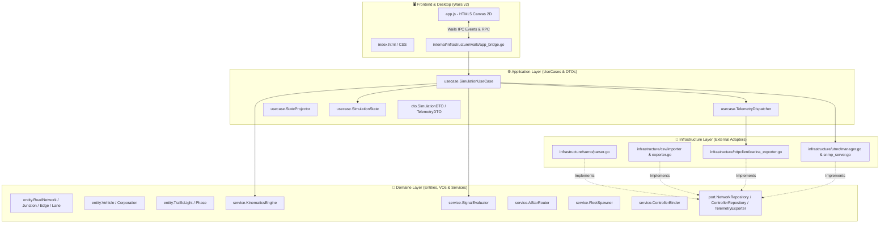

# 🗺️ Master Map of Content (MOC) & Graphe de Connaissances

Welcome to the **Master Map of Content (MOC)** for the **EVP Simulator**. This document serves as the primary technical directory on GitHub and the root navigation node for the **[Obsidian](https://obsidian.md/) Knowledge Vault**.

⬅️ [Hub de Documentation](README.md) | 🏛️ [Architecture](architecture.md) | 🚨 [EVP Walkthrough](evp_walkthrough.md) | 📖 [API Reference](api_and_protocols_reference.md)

---

## 🏛️ Codebase Layer Topology (Clean Architecture)

---

## 📂 Structural Package & Module Inventory

### 1. Domaine Layer (`internal/domain/`)
- [`entity/network.go`](file:///home/gabriel-moraes/Documentos/EVP_SIMULATOR/internal/domain/entity/network.go): Core road network entities (`RoadNetwork`, `Junction`, `Edge`, `Lane`, `Connection`, `Shape`).
- [`entity/vehicle.go`](file:///home/gabriel-moraes/Documentos/EVP_SIMULATOR/internal/domain/entity/vehicle.go): Emergency response vehicle entity (`Vehicle`), corporations (`SAMU`, `BOMBEIROS`, `POLICIA`), kinematics, and sirens.
- [`entity/traffic_light.go`](file:///home/gabriel-moraes/Documentos/EVP_SIMULATOR/internal/domain/entity/traffic_light.go): Signal controller entity (`TrafficLight`), phase stages, and preemption hold states.
- [`valueobject/`](file:///home/gabriel-moraes/Documentos/EVP_SIMULATOR/internal/domain/valueobject/): Immutable Value Objects (`Coordinate`, `SpeedKmh`, `VehicleMode`, `SignalState`).
- [`service/kinematics_engine.go`](file:///home/gabriel-moraes/Documentos/EVP_SIMULATOR/internal/domain/service/kinematics_engine.go): Euler numerical integration and acceleration curve calculation.
- [`service/signal_evaluator.go`](file:///home/gabriel-moraes/Documentos/EVP_SIMULATOR/internal/domain/service/signal_evaluator.go): Real-time approach distance evaluation, preemption triggering, and checkout detection.
- [`service/astar_router.go`](file:///home/gabriel-moraes/Documentos/EVP_SIMULATOR/internal/domain/service/astar_router.go): Min-Heap A\* shortest path routing on directed road networks.
- [`service/fleet_spawner.go`](file:///home/gabriel-moraes/Documentos/EVP_SIMULATOR/internal/domain/service/fleet_spawner.go): Procedural generator for emergency fleet missions across urban networks.
- [`service/controller_binder.go`](file:///home/gabriel-moraes/Documentos/EVP_SIMULATOR/internal/domain/service/controller_binder.go): Binds SUMO junctions to physical/emulated field controllers.
- [`port/`](file:///home/gabriel-moraes/Documentos/EVP_SIMULATOR/internal/domain/port/): Hexagonal interfaces (`NetworkRepository`, `ControllerRepository`, `TelemetryExporter`, `FleetExporter`).

### 2. Application Layer (`internal/application/`)
- [`usecase/simulation_usecase.go`](file:///home/gabriel-moraes/Documentos/EVP_SIMULATOR/internal/application/usecase/simulation_usecase.go): Simulation facade, 10 Hz tick loop, and state management.
- [`usecase/telemetry_dispatcher.go`](file:///home/gabriel-moraes/Documentos/EVP_SIMULATOR/internal/application/usecase/telemetry_dispatcher.go): Asynchronous telemetry streaming to the UI and CARINA CORE.
- [`usecase/state_projector.go`](file:///home/gabriel-moraes/Documentos/EVP_SIMULATOR/internal/application/usecase/state_projector.go): Projects domain entities into optimized JSON DTOs.
- [`dto/`](file:///home/gabriel-moraes/Documentos/EVP_SIMULATOR/internal/application/dto/): Data transfer objects (`SimulationStateDTO`, `VehicleStateDTO`, `TelemetryDTO`).

### 3. Infrastructure Layer (`internal/infrastructure/`)
- [`sumo/parser.go`](file:///home/gabriel-moraes/Documentos/EVP_SIMULATOR/internal/infrastructure/sumo/parser.go): Streaming XML parser for SUMO road networks with transparent gzip support (`.net.xml.gz`).
- [`utmc/snmp_server.go`](file:///home/gabriel-moraes/Documentos/EVP_SIMULATOR/internal/infrastructure/utmc/snmp_server.go): UDP SNMP agent servers emulating UTMC2/NTCIP 1202 field controllers.
- [`httpclient/carina_exporter.go`](file:///home/gabriel-moraes/Documentos/EVP_SIMULATOR/internal/infrastructure/httpclient/carina_exporter.go): Asynchronous fire-and-forget HTTP client exporting vehicle telemetry.
- [`csv/`](file:///home/gabriel-moraes/Documentos/EVP_SIMULATOR/internal/infrastructure/csv/): Controller inventory loading and fleet trajectory CSV exports.
- [`wails/app_bridge.go`](file:///home/gabriel-moraes/Documentos/EVP_SIMULATOR/internal/infrastructure/wails/app_bridge.go): Wails v2 desktop bridge linking Go use cases to JavaScript.

### 4. Frontend Layer (`frontend/`)
- [`app.js`](file:///home/gabriel-moraes/Documentos/EVP_SIMULATOR/frontend/app.js): HTML5 Canvas 2D engine with pan, zoom, road geometry rendering, and vehicle animations.
- [`index.html`](file:///home/gabriel-moraes/Documentos/EVP_SIMULATOR/frontend/index.html) & [`style.css`](file:///home/gabriel-moraes/Documentos/EVP_SIMULATOR/frontend/style.css): Desktop HUD, control buttons, and real-time telemetry inspector.

---

   
  <b>Noxfort Systems</b> — <i>A State Of Art Company</i> 
  <i>Ingénierie de Mobilité Intelligente • EVP Simulator v1.0.0</i>
  <small>SPDX-License-Identifier: <a href="../../LICENSE">Apache-2.0</a> • &copy; 2026 Noxfort Systems</small>

