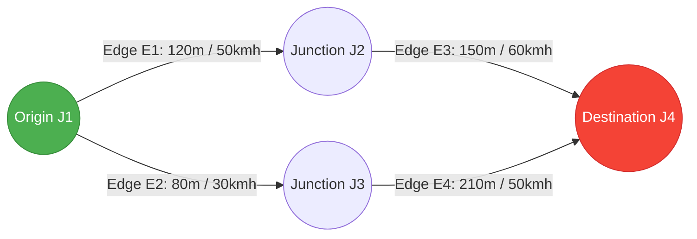

# 🚗 Moteur Cinématique & Ravitaillement A* sur Réseau Routier

This document describes the mathematical formulation of vehicle movement in `KinematicsEngine` and the shortest path search implemented in `AStarRouter`.

⬅️ [Hub de Documentation](README.md) | 🏛️ [Architecture](architecture.md) | 🚨 [EVP Walkthrough](evp_walkthrough.md) | 🗺️ [SUMO Parser](sumo_network_parser.md)

---

## 1. Euler Numerical Integration in `KinematicsEngine`

Vehicle coordinates update in discrete time steps ($\Delta t = 0.1\text{ s}$) using standard Euler numerical integration:

$$x(t + \Delta t) = x(t) + v(t) \cos(\theta) \Delta t$$
$$y(t + \Delta t) = y(t) + v(t) \sin(\theta) \Delta t$$
$$v(t + \Delta t) = \text{clamp}\left(0, v_{\text{max}}, v(t) + a(t) \Delta t\right)$$

Where:
- $(x, y)$: Cartesian planar coordinates in meters.
- $\theta$: Azimuth bearing angle guided by lane polylines.
- $a(t)$: Longitudinal acceleration based on driving mode and lane speed limit.

### 1.1 Acceleration Curve (Simplified IDM Model)
Vehicle acceleration dynamically scales based on the ratio of current speed $v$ to target speed $v_0$:

$$a = a_{\text{max}} \left[ 1 - \left(\frac{v}{v_0}\right)^4 \right]$$

- In `Emergency` mode: $a_{\text{max}} = 3.5\text{ m/s}^2$ with target speed up to $140\%$ of lane speed limit.
- In `Patrol` mode: $a_{\text{max}} = 1.8\text{ m/s}^2$ with $v_0 \le v_{\text{limit}}$.

---

## 2. A\* Routing Algorithm on Directed Road Graphs

`AStarRouter` computes optimal emergency routes on the directed road network graph:



### 2.1 Heuristic Evaluation Function
Admissibility is guaranteed by using straight-line Euclidean distance divided by global maximum velocity:

$$f(n) = g(n) + h(n)$$
$$g(n) = \sum_{e \in \text{path}} \frac{\text{length}(e)}{v_{\text{max}}(e)}$$
$$h(n) = \frac{\sqrt{(x_n - x_{\text{goal}})^2 + (y_n - y_{\text{goal}})^2}}{v_{\text{global\_max}}}$$

### 2.2 Go Priority Queue Implementation
Implemented using standard `container/heap`:

```go
type AStarNode struct {
    JunctionID string
    EdgeID     string
    CostG      float64
    CostH      float64
    CostF      float64
    Parent     *AStarNode
    Index      int
}

type PriorityQueue []*AStarNode

func (pq PriorityQueue) Less(i, j int) bool {
    return pq[i].CostF < pq[j].CostF
}
```

---

<div align="center">
  <br/>
  <b>Noxfort Systems</b> — <i>A State Of Art Company</i><br/>
  <i>Ingénierie de Mobilité Intelligente • EVP Simulator v1.0.0</i>
</div>
