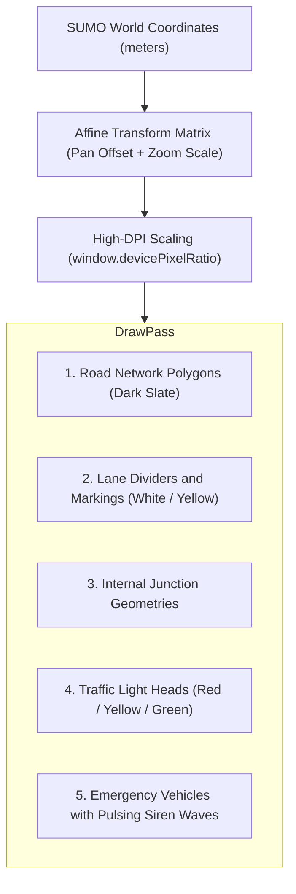

# 🖥️ Interface Graphique Desktop & Rendu Vectoriel Canvas 2D

This document describes the graphical user interface architecture implemented in `frontend/app.js` using **Wails v2** and **HTML5 Canvas 2D**.

⬅️ [Hub de Documentation](README.md) | 🏛️ [Architecture](architecture.md) | ⚡ [Wails Bridge](wails_ipc_and_bridges.md) | 🗺️ [SUMO Parser](sumo_network_parser.md)

---

## 1. 60 FPS 2D Vector Canvas Pipeline



---

## 2. Interactive Pan & Zoom Camera Controls

```javascript
canvas.addEventListener('wheel', (e) => {
    e.preventDefault();
    const zoomFactor = e.deltaY < 0 ? 1.15 : 0.85;
    const mouseX = e.offsetX;
    const mouseY = e.offsetY;

    const worldX = (mouseX - camera.x) / camera.scale;
    const worldY = (mouseY - camera.y) / camera.scale;

    camera.scale *= zoomFactor;
    camera.x = mouseX - worldX * camera.scale;
    camera.y = mouseY - worldY * camera.scale;
    requestRender();
});
```

---

<div align="center">
  <br/>
  <b>Noxfort Systems</b> — <i>A State Of Art Company</i><br/>
  <i>Ingénierie de Mobilité Intelligente • EVP Simulator v1.0.0</i>
  <small>SPDX-License-Identifier: <a href="../../LICENSE">Apache-2.0</a> • &copy; 2026 Noxfort Systems</small>
</div>
