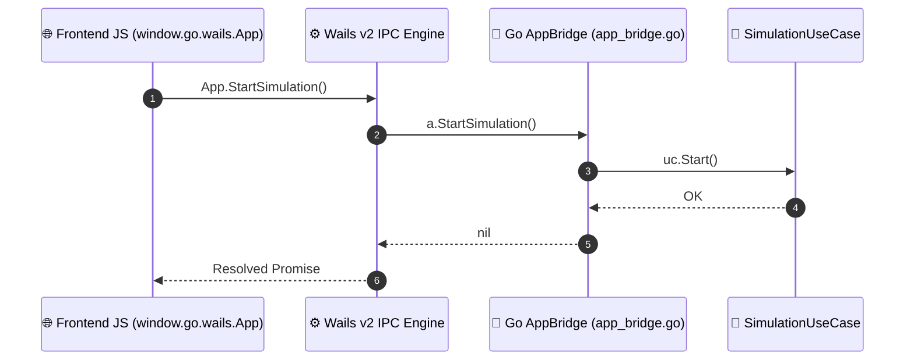

# ⚡ Pont IPC Wails v2 (Go ↔ JavaScript)

This document specifies the integration bridge connecting the Go backend with the JavaScript desktop GUI in `internal/infrastructure/wails/app_bridge.go`.

⬅️ [Hub de Documentation](README.md) | 🏛️ [Architecture](architecture.md) | 🖥️ [Desktop UI](ui_and_canvas_rendering.md) | 📖 [API Reference](api_and_protocols_reference.md)

---

## 1. Remote Procedure Call (RPC) Mechanism

Wails v2 automatically binds public methods on the Go struct `App` into JavaScript `window.go.wails.App`:



---

## 2. Real-Time Telemetry Event Streaming

```go
// Dispatched on every completed simulation tick
runtime.EventsEmit(a.ctx, "telemetry_tick", stateDTO)
```

In JavaScript:
```javascript
window.runtime.EventsOn("telemetry_tick", (state) => {
    updateVehiclePositions(state.vehicles);
    updateTrafficLightHeads(state.traffic_lights);
    requestCanvasRepaint();
});
```

---

<div align="center">
  <br/>
  <b>Noxfort Systems</b> — <i>A State Of Art Company</i><br/>
  <i>Ingénierie de Mobilité Intelligente • EVP Simulator v1.0.0</i>
  <small>SPDX-License-Identifier: <a href="../../LICENSE">Apache-2.0</a> • &copy; 2026 Noxfort Systems</small>
</div>
