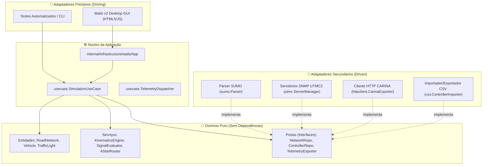
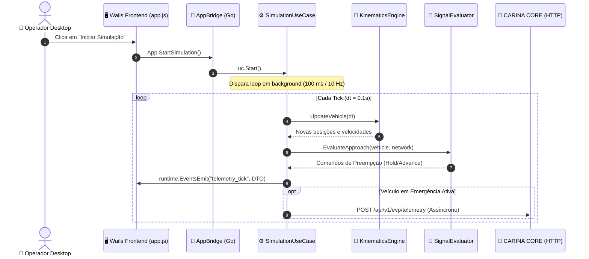

# 🏛️ Arquitetura do Sistema Go e Modelo de Concorrência

Este documento detalha os fundamentos de engenharia do **EVP Simulator**. A aplicação é construída em **Go 1.22** seguindo os princípios de **Clean Architecture**, **Domain-Driven Design (DDD)** e **Arquitetura Hexagonal (Ports & Adapters)**, garantindo desacoplamento total entre as regras cinemáticas de tráfego e as tecnologias de renderização e rede.

⬅️ [Central de Documentação](README.md) | 🗺️ [Master MOC](evp_moc.md) | 🚨 [Walkthrough EVP](evp_walkthrough.md) | ⚡ [Ponte Wails](wails_ipc_and_bridges.md)

---

## 1. Princípios de Arquitetura Hexagonal

O núcleo da simulação não possui dependência de bibliotecas externas, frameworks de interface gráfica ou protocolos de rede:

---

## 2. Modelo de Concorrência e Ciclo de Vida da Simulação

A simulação é orientada a passos de tempo discretos (*ticks*), executando em uma goroutine dedicada desacoplada do loop de eventos da interface gráfica:

### 2.1 Proteção de Estado e Thread-Safety
O estado global da simulação (`SimulationState`) é protegido por um mutex de leitura/escrita (`sync.RWMutex`):
- Operações de projeção de telemetria para a UI e exportação de dados utilizam `RLock()`, permitindo leituras concorrentes sem travar a interface.
- Operações de avanço de tick, spawn de veículos e reinicialização utilizam `Lock()`, garantindo mutação atômica e eliminando *data races*.

---

## 3. Desacoplamento de I/O de Rede via Buffer Não-Bloqueante

Para evitar que a latência de requisições HTTP externas para o backend CARINA afete a taxa de quadros (60 FPS) e o passo de física da simulação (10 Hz), o `TelemetryDispatcher` opera com fila delimitada assíncrona:
- As amostras de telemetria são enfileiradas em um canal Go com *buffer* de 1.000 mensagens.
- Uma goroutine trabalhadora dedicada consome do canal e despacha requisições HTTP via `POST /api/v1/evp/telemetry`.
- Caso o canal atinja o limite por instabilidade na rede local, mensagens excedentes não-críticas são descartadas com log de aviso (*load shedding*), mantendo a simulação rigorosamente fluida.

---

   
  <b>Noxfort Systems</b> — <i>A State Of Art Company</i> 
  <i>Engenharia de Mobilidade Inteligente • EVP Simulator v1.0.0</i>

