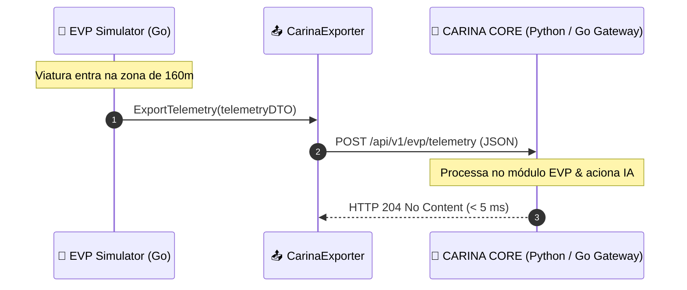

# 📡 Integração com CARINA CORE & Telemetria em Tempo Real

Este documento descreve a interface de comunicação entre o **EVP Simulator** e o cérebro de controle semafórico adaptativo **CARINA CORE**, implementada no pacote `internal/infrastructure/httpclient/carina_exporter.go`.

⬅️ [Central de Documentação](README.md) | 🏛️ [Arquitetura](architecture.md) | 🚨 [Walkthrough EVP](evp_walkthrough.md) | 🔌 [Emulação SNMP](utmc_and_snmp_emulation.md)

---

## 1. Protocolo de Comunicação Unidirecional (Fire-and-Forget)

Para espelhar a física real de viaturas operando com antenas GPS e modems celulares veiculares, a comunicação é estritamente **unidirecional assíncrona**:



- **Endpoint Padrão:** `POST http://localhost:8085/api/v1/evp/telemetry`
- **Status Esperado:** `204 No Content` (não bloqueia o cliente com payloads de resposta volumosos).
- **Timeout Rígido:** $200\text{ ms}$. Pacotes que excedem o tempo limite são descartados para evitar enfileiramento de posições desatualizadas.

---

## 2. Especificação do Esquema de Dados (JSON Schema)

```json
{
  "vehicle_id": "SAMU_UTI_01",
  "corporation": "SAMU",
  "latitude": -23.310284,
  "longitude": -51.162781,
  "speed_kmh": 64.8,
  "bearing": 182.5,
  "siren_active": true,
  "current_edge": "E_AV_BRASIL_02",
  "target_intersection": "J_CENTRO_04",
  "preemption_active": true,
  "timestamp": 1729188000123
}
```

### 2.1 Descrição dos Campos
- `vehicle_id` (`string`): Identificador único da viatura de emergência.
- `corporation` (`string`): Corporação operacional (`SAMU`, `BOMBEIROS`, `POLICIA_MILITAR`, `POLICIA_CIVIL`).
- `latitude` / `longitude` (`float64`): Coordenadas geodésicas convertidas a partir da malha viária SUMO.
- `speed_kmh` (`float64`): Velocidade escalar instantânea da viatura em km/h.
- `bearing` (`float64`): Azimute de navegação em graus ($0^\circ \text{ a } 360^\circ$).
- `siren_active` (`bool`): Indicador de acionamento do dispositivo de alarme sonoro regulamentar.
- `current_edge` (`string`): ID da via SUMO onde a viatura se encontra.
- `target_intersection` (`string`): ID da interseção de aproximação imediata.
- `preemption_active` (`bool`): `true` quando a viatura solicitou e está em preempção ativa.
- `timestamp` (`int64`): Epoch timestamp em milissegundos UTC.

---

<div align="center">
  <br/>
  <b>Noxfort Systems</b> — <i>A State Of Art Company</i><br/>
  <i>Engenharia de Mobilidade Inteligente • EVP Simulator v1.0.0</i>
  <small>SPDX-License-Identifier: <a href="../../LICENSE">Apache-2.0</a> • &copy; 2026 Noxfort Systems</small>
</div>
