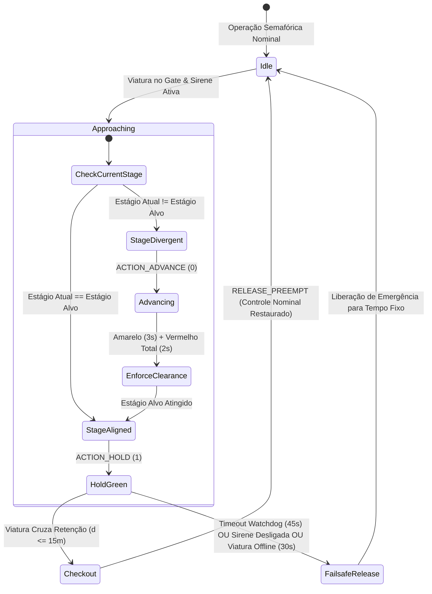

# 🚨 Arquitetura de Preempção de Veículos de Emergência (EVP) & Operações Remotas

Este documento especifica a arquitetura técnica do subsistema de **Preempção de Veículos de Emergência (EVP)** do CARINA localizado em [`src/evp/`](../../src/evp), o despachante de preempção em Go de alta velocidade em [`src_go/evp_go/`](../../src_go/evp_go), o **Web Gateway com Rede em Malha Tailscale** em [`src_go/web_gateway/`](../../src_go/web_gateway), e a **Interface Web de Videowall CCO (Central de Controle Operacional)** em [`src_tsx/src_cco/`](../../src_tsx/src_cco).

⬅️ Voltar ao [Portal Central MOC](carina_moc.md) | 🏛️ Ver [Arquitetura do Sistema](architecture.md) | 🛡️ Ver [Segurança e Watchdog](safety_and_watchdog.md) | 🚦 Ver [Controladores de Hardware](hardware_drivers.md)

---

## 1. Visão Geral e Marco Regulatório

O subsistema de Preempção de Veículos de Emergência (EVP) concede direito de passagem determinístico em tempo real (**Corredores Verdes**) a veículos de socorro em atendimento ativo — incluindo **SAMU** (Serviço de Atendimento Móvel de Urgência), **Corpo de Bombeiros** e **Forças Policiais** (Polícia Militar, Civil e Rodoviária).

O motor de EVP do CARINA segue rigorosamente as regulamentações de trânsito brasileiras (**Resolução CONTRAN nº 960** e **Art. 29, Inciso VII do Código de Trânsito Brasileiro - CTB**) e especificações internacionais de ITS (**FHWA MUTCD Seção 4D.26**):

1. **Prioridade Constitucional com Segurança Regulamentada (Art. 29 CTB):** A prioridade de trânsito exige o uso simultâneo de sinais sonoros e visuais de alarme (sirene ativa e giroscópio/estroboscópios). Mesmo sob preempção, os intervalos de segurança de transição (tempo de amarelo e vermelho de limpeza/*all-red*) são obrigatoriamente cumpridos para proteger pedestres e veículos em interseção.
2. **Disparo Determinístico de Dois Fatores (*Two-Factor Trigger*):** A preempção só é requisitada quando o veículo credenciado está **simultaneamente posicionado dentro do gate espacial de aproximação** ($60\text{ m} \le d \le 160\text{ m}$ ou comprimento real da quadra da rede) **E** com o **alarme sonoro de emergência ativado** (`siren_active = True`).
3. **Liberação Imediata de Checkout (*Checkout Clearance*):** Assim que a viatura cruza a linha de retenção do semáforo ($d \le 15\text{ m}$ dentro do cruzamento), o comando de preempção é liberado instantaneamente, evitando desperdício de tempo de verde.
4. **Watchdog Autônomo contra Travamentos:** Um temporizador watchdog incondicional de dwell máximo de 45 segundos desarma o corredor verde caso a viatura pare, desligue a sirene ou sofra colisão na aproximação, impedindo o bloqueio arterial perpétuo.

---

## 2. Arquitetura de Alto Nível do Subsistema

```mermaid
graph TD
    subgraph Frota de Viaturas
        GPS[Antena GPS / App Móvel] -->|HTTP POST 204 Fire-and-Forget| WebGW[Go Web Gateway porta 2201 / 8085]
    end

    subgraph Camada Go Gateway (src_go)
        WebGW --> TS[Tailscale Funnel / VPN Mesh]
        WebGW --> SSE[Hub de Transmissão SSE /cco/stream]
        WebGW --> EVP_Go[evp_go Dispatcher]
        WebGW -->|IPC Pipe Line JSON| GoClient[GoGatewayClient Python Proxy]
    end

    subgraph Núcleo CARINA (src/evp)
        GoClient --> EVPSvc[EVPService Singleton]
        EVPSvc --> FleetMgr[EVPFleetManager & Repositórios]
        EVPSvc --> Kinematics[EVPKinematicsEngine Haversine WGS84]
        EVPSvc --> PreemptEng[EVPPreemptionEngine Máquina de Estados]
        EVPSvc --> TopoSvc[EVPTopologyService Quadras Dinâmicas]
    end

    subgraph Firewall Neuro-Simbólico de Segurança
        PreemptEng -->|Intercepção Prioritária Regra 0| Auditor[SafetyAuditor Core]
        Auditor -->|Garante Amarelo & Vermelho Total| TransitionMgr[StageTransitionManager]
        TransitionMgr -->|Despacha HOLD ou ADVANCE| HardwareMgr[Controladores Físicos NTCIP/UTMC]
    end

    subgraph Painéis de Operação
        SSE --> CCO[CCO Web Map React/TSX src_tsx]
        EVPSvc -->|Barramento em Memória| FletUI[Interface Flet Desktop ui/cards/ & ui/widgets/]
    end
```

---

## 3. Modelo de Domínio e Entidades (`src/evp/evp_models.py`)

O modelo de domínio de EVP encapsula identificação, credenciamento municipal e telemetria cinemática:

### 3.1 Classificação de Corporações (`CorporationType`)

| Corporação | Código | Forma no Canvas UI | Cor Nominal | Cor de Alerta Sirene | Prioridade de Conflito |
| :--- | :---: | :---: | :---: | :---: | :---: |
| **SAMU (Ambulância)** | `SAMU` | Triângulo ($\Delta$) | Branco (`#FFFFFF`) | Vermelho Vivo (`#E53935`) | Prioridade 1 (Salva-Vidas) |
| **Corpo de Bombeiros** | `BOMBEIRO` | Quadrado ($\square$) | Âmbar (`#FF8C00`) | Laranja Fogo (`#FF3D00`) | Prioridade 1 (Salva-Vidas) |
| **Polícia (Civil / Militar)** | `POLICIA` | Círculo ($\bigcirc$) | Azul Escuro (`#1E3A8A`) | Azul Royal (`#2563EB`) | Prioridade 2 (Ordem Pública) |

### 3.2 Entidade de Frota Credenciada (`RegisteredVehicle`)
Representa um veículo de emergência oficialmente autorizado a interagir com o CARINA:
- `vehicle_id` (ex: `"SAMU-01"`): Código único alfanumérico da viatura.
- `corporation`: Tipo da corporação (`CorporationType`).
- `plate`: Placa oficial do veículo.
- `ip_address` / `port`: Parâmetros de rede do transponder embarcado.
- `auth_token`: Token criptográfico opcional para autenticação de telemetria.
- `is_active`: Chave de habilitação administrativa.

### 3.3 Raiz de Agregação Dinâmica (`EmergencyVehicle`)
Encapsula a telemetria em tempo real, estado espacial e ciclo de vida de preempção:
- Geolocalização: `latitude`, `longitude`, `speed_kmh`, `heading_deg`.
- Modo de operação: `siren_active` (booleano).
- Estado de preempção: `is_evp_triggered`, `active_intersection_id`, `active_intersections` (conjunto), `dwell_start_time`.
- Conectividade: `is_online` avaliado contra `offline_timeout_seconds` (padrão: $30.0\text{ s}$).

---

## 4. Cinemática Geodésica e Detecção Espacial (`src/evp/evp_kinematics.py`)

As distâncias geodésicas são computadas via **Fórmula de Haversine** sobre o elipsoide WGS84 ($R = 6.371.000\text{ m}$):

$$\Delta\phi = \text{radianos}(\phi_2 - \phi_1), \quad \Delta\lambda = \text{radianos}(\lambda_2 - \lambda_1)$$

$$a = \sin^2\left(\frac{\Delta\phi}{2}\right) + \cos(\phi_1)\cos(\phi_2)\sin^2\left(\frac{\Delta\lambda}{2}\right)$$

$$c = 2 \cdot \text{atan2}\left(\sqrt{a}, \sqrt{1 - a}\right), \quad d = R \cdot c$$

```text
  Gate de Entrada na Quadra                           Linha de Retenção
     (60m <= d <= 160m)                              (Checkout: d <= 15m)
─────────┬─────────────────────────────────────────────────────┬─────────►
         │ <───────────── Zona de Aproximação ───────────────> │
   Viatura Entra                                         Viatura Cruza
   Preempção Disparada                                   Preempção Liberada
   (se siren_active=True)                                (Retorno Imediato ao Normal)
```

### 4.1 Gatilho de Entrada na Quadra (`is_at_block_entrance`)
- Avalia se a distância até o semáforo satisfaz:
  
  $$d_{\text{min}} \le d_{\text{viatura}} \le d_{\text{max}}$$
  
  Onde $d_{\text{min}} = 60,0\text{ m}$ e $d_{\text{max}} = 160,0\text{ m}$ (ou o comprimento real do link viário $L_{\text{quadra}}$ obtido via [`EVPTopologyService`](../../src/evp/evp_topology_service.py)).

### 4.2 Detecção de Checkout (`has_checked_out`)
- Quando $d_{\text{viatura}} \le 15,0\text{ m}$ e a trajetória avança além da linha de retenção, o motor executa o checkout atômico, liberando o estágio semafórico.

---

## 5. Máquina de Estados e Ciclo de Vida (`src/evp/evp_preemption_engine.py`)

A máquina de estados gerencia as transições de estágio sem violar os tempos de segurança de entreverdes:



### 5.1 Ações de Preempção
- **`ACTION_HOLD` (1):** Mantido quando o estágio físico atual corresponde à fase do corredor de emergência (`target_stage`). Impede o controlador físico de encerrar o verde até a viatura cruzar o semáforo.
- **`ACTION_ADVANCE` (0):** Emitido quando o controlador está em estágio conflitante. Requisita avanço imediato de fases cumprindo os tempos regulamentares de amarelo e vermelho total.

### 5.2 Temporizadores de Segurança e Watchdog
1. **Dwell Máximo CONTRAN ($45,0\text{ s}$):** Se a preempção permanecer ativa por mais de 45 segundos no mesmo cruzamento, ela é cancelada incondicionalmente para desovar o tráfego transversal.
2. **Timeout de Viatura Offline ($30,0\text{ s}$):** Se a telemetria cessar por $> 30\text{ s}$, a viatura é marcada como offline e a preempção é abortada.
3. **Desativação de Sirene:** Se o motorista desligar a sirene (`siren_active = False`), o corredor verde é desarmado imediatamente.

---

## 6. Integração com o Auditor de Segurança (`SafetyAuditor`)

No [`src/core/safety_auditor.py`](../../src/core/safety_auditor.py), a preempção de EVP é avaliada como a **Regra nº 0 (Intercepção de Prioridade de Emergência)** antes de qualquer proposta de IA ou regra simbólica SR-01 a SR-05:

```python
# 0. Intercepção de Prioridade de Emergência (EVP - Emergency Vehicle Preemption)
try:
    from src.evp.evp_bridge import EVPBridge
    bridge = EVPBridge()
    evp_action, is_evp, _ = bridge.intercept_safety_audit(
        tl_id=tl_id,
        current_stage=current_stage_idx,
        stage_duration=current_stage_duration,
        suggested_action=suggested_action,
    )
    if is_evp and evp_action is not None:
        if evp_action == 1:
            self.last_veto_reasons[tl_id] = "Preempção de Veículo de Emergência (EVP - Corredor Verde Ativo)"
        return evp_action, (evp_action == 1)
except Exception:
    pass
```

---

## 7. Despachante de Hardware de Alta Performance (`src_go/evp_go/`)

O executável compilado em Go (`bin/carina-go`) executa as ordens de preempção em microsegundos sobre controladores NTCIP 1202 e UTMC2:

### 7.1 Roteamento do Despachante (`dispatcher.go`)
- Recebe mensagens `PreemptionCommand` do roteador do gateway.
- `activate_preempt`: Insere máscaras OID `ascPhaseHold` via SNMP na porta UDP 161.
- `release_preempt`: Zera as máscaras de retenção, retornando o semáforo aos planos de coordenação locais.

---

## 8. Gateway Web e Operações Remotas (`src_go/web_gateway/`)

O Web Gateway em Go expõe portas para telemetria veicular e operação em navegadores:

```text
                  TAILSCALE FUNNEL (Porta 2201 / HTTPS)
                     (Acesso Seguro Público/Privado)
                                │
               ┌────────────────┴────────────────┐
               ▼                                 ▼
       /api/v1/evp/telemetry                 /cco/stream
    (Antenas GPS das Viaturas)          (Videowalls Web CCO)
    - HTTP POST (Fire-and-Forget)       - Server-Sent Events (SSE)
    - HTTP 204 No Content               - Quadros JSON em Tempo Real
```

### 8.1 Ingestão Unidirecional de GPS (`handlers_evp.go`)
- **Rota:** `POST /api/v1/evp/telemetry` (e alias `/amb`)
- **Resposta:** `204 No Content`
- **Latência de Ingestão:** $< 0,5\text{ ms}$
- **Esquema de Carga:**
  ```json
  {
    "vehicle_id": "SAMU-01",
    "corporation": "SAMU",
    "latitude": -23.31028,
    "longitude": -51.16278,
    "speed_kmh": 68.5,
    "heading_deg": 182.0,
    "siren_active": true,
    "timestamp": 1789458600.0
  }
  ```

### 8.2 Integração com Tailscale Funnel (`tailscale.go`)
- Cria túneis criptografados de borda sem necessidade de IP público estático ou abertura de portas de firewall.
- Consulta o status da máquina via sockets IPC locais do Tailscale para expor a URL pública do CCO.

---

## 9. Interface Web do Operador de Controle Central CCO (`src_tsx/src_cco/`)

Videowall operacional moderno construído com **React 18**, **TypeScript**, **Tailwind CSS** e **Apache ECharts**:

- **Subscrição SSE em Tempo Real:** [`SseCcoStreamService.ts`](../../src_tsx/src_cco/infrastructure/stream/SseCcoStreamService.ts) conecta ao `/cco/stream` sem necessidade de polling de navegador.
- **Camadas de Mapa Vetorial:**
  - `MapRoadsLayer.tsx`: Vias codificadas por cor conforme a velocidade e ocupação.
  - `MapTrafficLightsLayer.tsx`: Indicação em tempo real dos focos semafóricos.
  - `MapEmergencyVehiclesLayer.tsx`: Marcadores geométricos estroboscópicos das viaturas.
- **Notificações:** [`EvpAlertToast.tsx`](../../src_tsx/src_cco/presentation/components/EvpAlertToast.tsx) exibe alertas imediatos no videowall sempre que um corredor verde é ativado.

---

## 10. Integração com a Interface Desktop Flet (`ui/`)

A interface nativa Flet possui componentes dedicados para gestão de preempção:

### 10.1 Cartas de Configuração (`ui/cards/`)
- **`EVPFleetConnectionCard` (`evp_fleet_connection_card.py`):**
  - Tabela com frotas credenciadas e controle de viaturas autorizadas.
  - Importação e exportação de credenciais via CSV.
  - Indicadores de atividade e conexão online/offline.
- **`EVPSafetyParametersCard` (`evp_safety_parameters_card.py`):**
  - Configuração do gate de entrada da quadra ($60\text{--}160\text{ m}$).
  - Limite de dwell máximo do watchdog ($15\text{--}120\text{ s}$).
  - Auto-registro opcional de frotas não cadastradas.

### 10.2 Widgets de Canvas (`ui/widgets/`)
- **`EVPVehicleMarker` (`evp_vehicle_marker.py`):** Marcador vetorial de alta precisão com estroboscópio pulsante a $2,5\text{ Hz}$.
- **`EVPVehicleCard` (`evp_vehicle_card.py`):** Cartão flutuante exibindo velocidade, aproximação e previsão de chegada (ETA).

---

## 11. Esquemas de Banco de Dados Relacional

Persistência no SQLite e PostgreSQL com auditoria forense:

### 11.1 Tabela: `evp_registered_fleet`
```sql
CREATE TABLE IF NOT EXISTS evp_registered_fleet (
    vehicle_id VARCHAR(64) PRIMARY KEY,
    corporation VARCHAR(32) NOT NULL,
    plate VARCHAR(16),
    description VARCHAR(128),
    device_id VARCHAR(64),
    ip_address VARCHAR(45),
    port INT DEFAULT 8085,
    protocol VARCHAR(16) DEFAULT 'HTTP',
    auth_token VARCHAR(128),
    is_active BOOLEAN DEFAULT TRUE,
    created_at TIMESTAMP DEFAULT CURRENT_TIMESTAMP
);
```

### 11.2 Tabela: `evp_telemetry_records`
```sql
CREATE TABLE IF NOT EXISTS evp_telemetry_records (
    id BIGSERIAL PRIMARY KEY,
    vehicle_id VARCHAR(64) NOT NULL,
    corporation VARCHAR(32) NOT NULL,
    latitude DOUBLE PRECISION NOT NULL,
    longitude DOUBLE PRECISION NOT NULL,
    speed_kmh REAL NOT NULL,
    heading_deg REAL NOT NULL,
    siren_active BOOLEAN NOT NULL,
    evp_triggered BOOLEAN NOT NULL DEFAULT FALSE,
    intersection_id VARCHAR(64),
    created_at TIMESTAMP DEFAULT CURRENT_TIMESTAMP
);

CREATE INDEX idx_evp_veh_time ON evp_telemetry_records (vehicle_id, created_at DESC);
```

### 11.3 Tabela: `evp_denied_fleet`
```sql
CREATE TABLE IF NOT EXISTS evp_denied_fleet (
    vehicle_id VARCHAR(64) PRIMARY KEY,
    denied_at TIMESTAMP DEFAULT CURRENT_TIMESTAMP
);
```

---

## 12. Validação e Testes Automatizados

### 12.1 Suíte de Testes com Pytest
O subsistema de EVP conta com 12 módulos de testes unitários em `tests/unit/`:
```bash
pytest tests/unit/test_evp_*.py -v
```

Principais módulos:
- `test_evp_service.py`: Disparo por dois fatores, regras CONTRAN e ciclo de vida.
- `test_evp_kinematics.py`: Cálculo de Haversine, gates de entrada e saída.
- `test_evp_preemption_engine.py`: Retenção de fase, expiração de watchdog e fail-safe.
- `test_evp_fleet_persistence.py` & `test_evp_fleet_csv.py`: Persistência em banco e sincronização CSV.

### 12.2 Simulador CLI de Viaturas (`demo/evp_vehicle_simulator.py`)
Para simular viaturas em aproximação no ambiente de desenvolvimento:
```bash
# Corrida de emergência com sirene ativa (SAMU-01)
python demo/evp_vehicle_simulator.py --vehicle SAMU-01 --mode emergency

# Modo de patrulha contínua da frota (SAMU, Bombeiros, Polícia)
python demo/evp_vehicle_simulator.py --mode patrol --duration 60
```

---

<div align="center">
  <br/>
  <b>Noxfort Systems</b> — <i>A State Of Art Company</i><br/>
  <i>Intelligent Mobility Engineering • CARINA CORE v1.2.0</i><br/>
  <small>© 2026 Noxfort Systems. Licenciado sob AGPLv3.</small>
</div>
