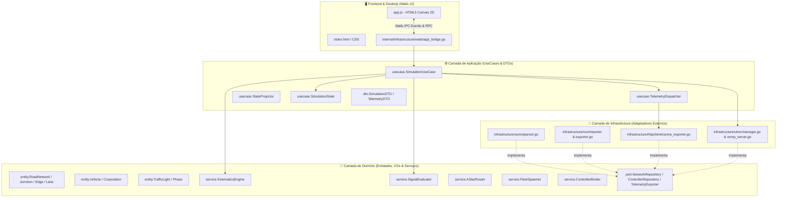

# 🗺️ Master Map of Content (MOC) & Grafo de Conhecimento

Bem-vindo ao **Master Map of Content (MOC)** do **EVP Simulator**. Este documento serve como índice central navegável no GitHub e nó raiz de navegação bidirecional no **[Obsidian](https://obsidian.md/) Knowledge Vault**.

⬅️ [Central de Documentação](README.md) | 🏛️ [Arquitetura](architecture.md) | 🚨 [Walkthrough EVP](evp_walkthrough.md) | 📖 [Referência de APIs](api_and_protocols_reference.md)

---

## 🏛️ Topologia de Camadas da Base de Código (Clean Architecture)

---

## 📂 Inventário Estrutural de Pacotes e Módulos

### 1. Camada de Domínio (`internal/domain/`)
- [`entity/network.go`](file:///home/gabriel-moraes/Documentos/EVP_SIMULATOR/internal/domain/entity/network.go): Estruturas fundamentais de malha viária (`RoadNetwork`, `Junction`, `Edge`, `Lane`, `Connection`, `Shape`).
- [`entity/vehicle.go`](file:///home/gabriel-moraes/Documentos/EVP_SIMULATOR/internal/domain/entity/vehicle.go): Entidade de veículo de emergência (`Vehicle`), corporações (`SAMU`, `BOMBEIROS`, `POLICIA`), cinemática e sirenes.
- [`entity/traffic_light.go`](file:///home/gabriel-moraes/Documentos/EVP_SIMULATOR/internal/domain/entity/traffic_light.go): Controlador de tráfego (`TrafficLight`), fases semafóricas e estados de preempção.
- [`valueobject/`](file:///home/gabriel-moraes/Documentos/EVP_SIMULATOR/internal/domain/valueobject/): Value Objects imutáveis (`Coordinate`, `SpeedKmh`, `VehicleMode`, `SignalState`).
- [`service/kinematics_engine.go`](file:///home/gabriel-moraes/Documentos/EVP_SIMULATOR/internal/domain/service/kinematics_engine.go): Atualização cinemática discreta por integração de Euler e curvas de aceleração.
- [`service/signal_evaluator.go`](file:///home/gabriel-moraes/Documentos/EVP_SIMULATOR/internal/domain/service/signal_evaluator.go): Avaliação em tempo real de distância ao cruzamento, gatilho de preempção e checkout.
- [`service/astar_router.go`](file:///home/gabriel-moraes/Documentos/EVP_SIMULATOR/internal/domain/service/astar_router.go): Roteamento de menor custo A* em grafos viários com Min-Heap.
- [`service/fleet_spawner.go`](file:///home/gabriel-moraes/Documentos/EVP_SIMULATOR/internal/domain/service/fleet_spawner.go): Gerador procedural de viaturas de emergência em rotas urbanas.
- [`service/controller_binder.go`](file:///home/gabriel-moraes/Documentos/EVP_SIMULATOR/internal/domain/service/controller_binder.go): Associação de junções SUMO a controladores de campo.
- [`port/`](file:///home/gabriel-moraes/Documentos/EVP_SIMULATOR/internal/domain/port/): Contratos e interfaces (`NetworkRepository`, `ControllerRepository`, `TelemetryExporter`, `FleetExporter`).

### 2. Camada de Aplicação (`internal/application/`)
- [`usecase/simulation_usecase.go`](file:///home/gabriel-moraes/Documentos/EVP_SIMULATOR/internal/application/usecase/simulation_usecase.go): Fachada principal da simulação, loop de ticks (10 Hz) e controle de estado.
- [`usecase/telemetry_dispatcher.go`](file:///home/gabriel-moraes/Documentos/EVP_SIMULATOR/internal/application/usecase/telemetry_dispatcher.go): Despacho assíncrono de eventos para a UI e para a CARINA CORE.
- [`usecase/state_projector.go`](file:///home/gabriel-moraes/Documentos/EVP_SIMULATOR/internal/application/usecase/state_projector.go): Projeção de entidades em DTOs otimizados para serialização JSON.
- [`dto/`](file:///home/gabriel-moraes/Documentos/EVP_SIMULATOR/internal/application/dto/): Objetos de transferência de dados (`SimulationStateDTO`, `VehicleStateDTO`, `TelemetryDTO`).

### 3. Camada de Infraestrutura (`internal/infrastructure/`)
- [`sumo/parser.go`](file:///home/gabriel-moraes/Documentos/EVP_SIMULATOR/internal/infrastructure/sumo/parser.go): Parser de redes XML do SUMO com suporte transparente a gzip (`.net.xml.gz`).
- [`utmc/snmp_server.go`](file:///home/gabriel-moraes/Documentos/EVP_SIMULATOR/internal/infrastructure/utmc/snmp_server.go): Servidor agente SNMP UDP para emulação de controladores UTMC2/NTCIP.
- [`httpclient/carina_exporter.go`](file:///home/gabriel-moraes/Documentos/EVP_SIMULATOR/internal/infrastructure/httpclient/carina_exporter.go): Cliente HTTP REST Fire-and-Forget para despacho de telemetria à CARINA.
- [`csv/`](file:///home/gabriel-moraes/Documentos/EVP_SIMULATOR/internal/infrastructure/csv/): Importação de inventário de controladores e exportação de telemetria em CSV.
- [`wails/app_bridge.go`](file:///home/gabriel-moraes/Documentos/EVP_SIMULATOR/internal/infrastructure/wails/app_bridge.go): Adaptador de ponte Wails v2 ligando Go ao JavaScript.

### 4. Camada de Frontend (`frontend/`)
- [`app.js`](file:///home/gabriel-moraes/Documentos/EVP_SIMULATOR/frontend/app.js): Motor em HTML5 Canvas 2D com pan, zoom, renderização de vias, semáforos e animação de viaturas.
- [`index.html`](file:///home/gabriel-moraes/Documentos/EVP_SIMULATOR/frontend/index.html) & [`style.css`](file:///home/gabriel-moraes/Documentos/EVP_SIMULATOR/frontend/style.css): Painel de instrumentação, botões de ação e HUD de telemetria.

---

   
  <b>Noxfort Systems</b> — <i>A State Of Art Company</i> 
  <i>Engenharia de Mobilidade Inteligente • EVP Simulator v1.0.0</i>

