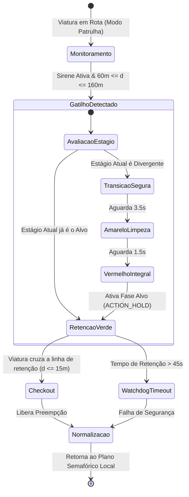

# 🚨 Walkthrough Técnico de Preempção de Emergência (EVP)

Este documento especifica os algoritmos de **Preempção Veicular de Emergência (EVP)** implementados no EVP Simulator. A arquitetura obedece rigorosamente às exigências de segurança viária do **CONTRAN (Resolução nº 960)**, ao **Art. 29, Inciso VII do Código de Trânsito Brasileiro (CTB)** e aos parâmetros da **FHWA MUTCD (Seção 4D.26)**.

⬅️ [Central de Documentação](README.md) | 🏛️ [Arquitetura](architecture.md) | 🚗 [Cinemática](kinematics_and_routing.md) | 🛡️ [Segurança](signal_evaluation_and_safety.md)

---

## 1. Princípios Regulatórios da Prioridade de Passagem

De acordo com o **Artigo 29, VII do CTB**, veículos destinados a socorro de incêndio e salvamento, ambulâncias e viaturas policiais gozam de prioridade de trânsito e livre circulação **exclusivamente quando em serviço de urgência e devidamente identificados por dispositivos regulamentares de alarme sonoro (sirene) e iluminação vermelha intermitente (giroflex)**.

O EVP Simulator modela esta restrição através de um **Gatilho de Duplo Fator**:
1. **Fator Físico/Espacial:** A viatura deve estar posicionada dentro da zona geométrica de aproximação do cruzamento ($60\text{ m} \le d \le 160\text{ m}$).
2. **Fator Operacional:** A sirene sonora deve estar formalmente ligada (`SirenActive == true`).

---

## 2. Ciclo de Vida da Preempção Semafórica



---

## 3. Delimitação das Zonas Espaciais de Atuação

```text
                               Zona de Chegada (Stop-Line)
      Zona de Pré-Aviso              Zona de Gatilho EVP          Checkout
   [> 160m da Junção]           [60m <= d <= 160m]              [d <= 15m]
────────────────────────────┬─────────────────────────────┬────────────────────┼──── Cruzamento
   Monitora Cinemática      │  Emite Requisição de EVP    │ Libera Preempção   │
   Sem Comutação de Fase    │  Comuta para Amarelo/Verde  │ Retorna Ciclo      │
────────────────────────────┴─────────────────────────────┴────────────────────┴────
```

### 3.1 Equacionamento Cinemático de Aproximação
A distância Euclidiana $d$ entre a coordenada do veículo $(x_v, y_v)$ e a linha de retenção do estágio $(x_j, y_j)$ é dada por:

$$d = \sqrt{(x_j - x_v)^2 + (y_j - y_v)^2}$$

O tempo estimado para chegada (*Time-to-Clearance* - TTC) é avaliado dinamicamente com base na velocidade vetorial instantânea $v$:

$$\text{TTC} = \frac{d}{v}$$

Se $\text{TTC} \le 8\text{ s}$ e a viatura se encontra na faixa correta de aproximação conectada ao estágio, a transição semafórica é engatada.

### 3.2 Watchdog Fail-Safe de 45 Segundos
Para evitar travamentos permanentes da malha urbana caso a viatura sofra um acidente, estacione ou desligue a sirene dentro da zona de preempção, o controlador mantém um timer incondicional de **45 segundos**. Ao expirar, a prioridade é revogada compulsoriamente e o controlador retoma sua coordenação adaptativa ou tempo fixo.

---

<div align="center">
  <br/>
  <b>Noxfort Systems</b> — <i>A State Of Art Company</i><br/>
  <i>Engenharia de Mobilidade Inteligente • EVP Simulator v1.0.0</i>
  <small>SPDX-License-Identifier: <a href="../../LICENSE">Apache-2.0</a> • &copy; 2026 Noxfort Systems</small>
</div>
