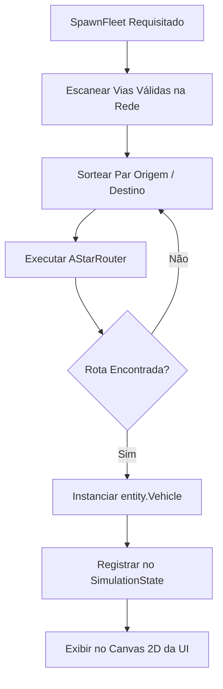

# 🚑 Gerenciamento de Frotas de Emergência & `FleetSpawner`

Este documento aborda a modelagem, criação e gerenciamento dinâmico de veículos de emergência no EVP Simulator, implementado em `internal/domain/service/fleet_spawner.go` e `internal/domain/entity/vehicle.go`.

⬅️ [Central de Documentação](README.md) | 🏛️ [Arquitetura](architecture.md) | 🚗 [Cinemática](kinematics_and_routing.md) | 📊 [CSV Exchanger](csv_data_exchanger.md)

---

## 1. Tipologia de Corporações e Viaturas

O simulador suporta diferentes tipos de veículos com características físicas e operacionais customizadas:

| Corporação | Tipo de Viatura | Aceleração Máx | Velocidade Limite | Cor de Renderização |
| :--- | :--- | :---: | :---: | :---: |
| **SAMU** | Ambulância / UTI Móvel | $3.0\text{ m/s}^2$ | $80\text{ km/h}$ | 🟡 Amarelo / 🔴 Vermelho |
| **BOMBEIROS** | Auto Bomba Tanque / Resgate | $2.2\text{ m/s}^2$ | $70\text{ km/h}$ | 🔴 Vermelho Vivo |
| **POLICIA_MILITAR** | Viatura de Patrulhamento Tático | $3.8\text{ m/s}^2$ | $90\text{ km/h}$ | 🔵 Azul Cobalto |
| **POLICIA_CIVIL** | Viatura Descaracterizada | $3.5\text{ m/s}^2$ | $85\text{ km/h}$ | ⚫ Cinza Escuro |

---

## 2. Geração Procedural de Missões e Rotas

O `FleetSpawner` utiliza o `AStarRouter` para definir missões com trajetórias plausíveis na malha viária:
1. **Seleção de Origem e Destino:** Identifica pares de junções diametralmente opostas ou nós periféricos da cidade.
2. **Cálculo da Rota:** Computa a sequência ordenada de `Edges` garantindo conexões válidas.
3. **Injeção de Estado:** Instancia a viatura no início da primeira via, configurando o velocímetro em $0\text{ km/h}$ e determinando o modo operacional inicial (`Patrol` ou `Emergency`).

---

   
  <b>Noxfort Systems</b> — <i>A State Of Art Company</i> 
  <i>Engenharia de Mobilidade Inteligente • EVP Simulator v1.0.0</i>

