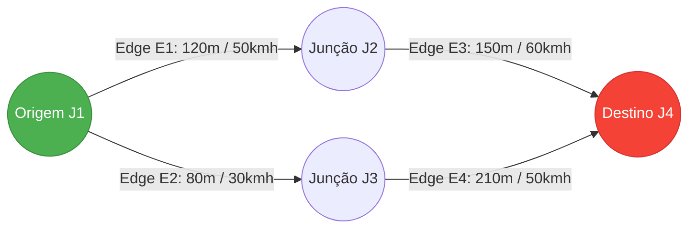

# 🚗 Motor Cinemático & Roteamento em Grafos Viários (A*)

Este documento descreve a modelagem matemática de movimento veicular implementada no `KinematicsEngine` e o algoritmo de busca heurística de caminho mínimo implementado no `AStarRouter`.

⬅️ [Central de Documentação](README.md) | 🏛️ [Arquitetura](architecture.md) | 🚨 [Walkthrough EVP](evp_walkthrough.md) | 🗺️ [Parser SUMO](sumo_network_parser.md)

---

## 1. Integração Numérica de Euler no `KinematicsEngine`

O movimento translacional dos veículos é atualizado em tempo discreto a cada tick ($\Delta t = 0.1\text{ s}$) utilizando o método de integração de Euler:

$$x(t + \Delta t) = x(t) + v(t) \cos(\theta) \Delta t$$
$$y(t + \Delta t) = y(t) + v(t) \sin(\theta) \Delta t$$
$$v(t + \Delta t) = \text{clamp}\left(0, v_{\text{max}}, v(t) + a(t) \Delta t\right)$$

Onde:
- $(x, y)$: Coordenadas cartesianas no plano do mapa (metros).
- $\theta$: Ângulo de azimute (*bearing*) orientado pela geometria da faixa.
- $a(t)$: Aceleração longitudinal calculada de acordo com o modo de condução e o limite regulamentar da via.

### 1.1 Curva de Aceleração com Base no Modelo Intelligent Driver (IDM Simplificado)
Para aproximações realistas, a aceleração de viaturas varia conforme a discrepância para a velocidade-alvo $v_0$:

$$a = a_{\text{max}} \left[ 1 - \left(\frac{v}{v_0}\right)^4 \right]$$

- No modo `Emergency`, $a_{\text{max}} = 3.5\text{ m/s}^2$ e $v_0$ atinge até $140\%$ da velocidade máxima permitida na faixa.
- No modo `Patrol`, $a_{\text{max}} = 1.8\text{ m/s}^2$ e $v_0 \le v_{\text{limite}}$.

---

## 2. Algoritmo de Roteamento A\* em Grafo Direcionado

O `AStarRouter` opera sobre o grafo viário construído a partir das junções e vias da rede SUMO. Cada nó representa uma junção viária, e cada aresta direcionada representa uma via (`Edge`) com custo ponderado pela extensão física e velocidade regulamentar:



### 2.1 Função de Avaliação Heurística
Para garantir monotonicidade e optimalidade (*admissibility*), a heurística $h(n)$ utiliza a distância euclidiana em linha reta até a junção-alvo:

$$f(n) = g(n) + h(n)$$
$$g(n) = \sum_{e \in \text{caminho}} \frac{\text{comprimento}(e)}{v_{\text{máx}}(e)}$$
$$h(n) = \frac{\sqrt{(x_n - x_{\text{alvo}})^2 + (y_n - y_{\text{alvo}})^2}}{v_{\text{global\_max}}}$$

### 2.2 Implementação com Min-Heap em Go
A fila de prioridade implementa a interface `container/heap`:

```go
type AStarNode struct {
    JunctionID string
    EdgeID     string
    CostG      float64
    CostH      float64
    CostF      float64
    Parent     *AStarNode
    Index      int
}

type PriorityQueue []*AStarNode

func (pq PriorityQueue) Less(i, j int) bool {
    return pq[i].CostF < pq[j].CostF
}
```

---

<div align="center">
  <br/>
  <b>Noxfort Systems</b> — <i>A State Of Art Company</i><br/>
  <i>Engenharia de Mobilidade Inteligente • EVP Simulator v1.0.0</i>
  <small>SPDX-License-Identifier: <a href="../../LICENSE">Apache-2.0</a> • &copy; 2026 Noxfort Systems</small>
</div>
