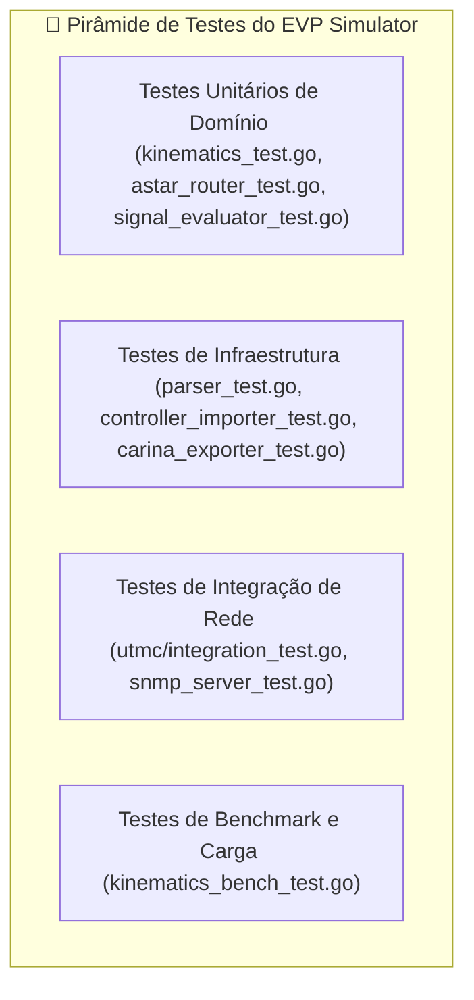

# 🧪 Diretrizes de Testes & Validação de Qualidade

Este documento especifica os procedimentos de garantia de qualidade (QA), testes unitários, testes de integração e testes de desempenho do **EVP Simulator**.

⬅️ [Central de Documentação](README.md) | 🏛️ [Arquitetura](architecture.md) | 🚗 [Cinemática](kinematics_and_routing.md) | 🛠️ [Guia do Desenvolvedor](developer_guides.md)

---

## 1. Executando a Suíte de Testes

Os testes são executados através da ferramenta nativa `go test`:

```bash
# Executa todos os testes da aplicação com exibição detalhada e cobertura
go test -v -cover ./...
```

---

## 2. Estratégia de Testes por Pacote



### 2.1 Padrão Table-Driven Tests
Todos os testes unitários utilizam a convenção idiomática de *Table-Driven Tests* de Go:

```go
func TestKinematicsEulerIntegration(t *testing.T) {
    cases := []struct {
        name          string
        initialSpeed  valueobject.SpeedKmh
        dt            float64
        expectedDist  float64
    }{
        {"Velocidade zero", 0, 0.1, 0.0},
        {"60 km/h por 1 segundo", 60, 1.0, 16.666},
        {"90 km/h por 100 ms", 90, 0.1, 2.5},
    }

    for _, tc := range cases {
        t.Run(tc.name, func(t *testing.T) {
            dist := tc.initialSpeed.ToMps() * tc.dt
            if math.Abs(dist - tc.expectedDist) > 0.01 {
                t.Errorf("Esperado %.3f m, obtido %.3f m", tc.expectedDist, dist)
            }
        })
    }
}
```

---

<div align="center">
  <br/>
  <b>Noxfort Systems</b> — <i>A State Of Art Company</i><br/>
  <i>Engenharia de Mobilidade Inteligente • EVP Simulator v1.0.0</i>
</div>
