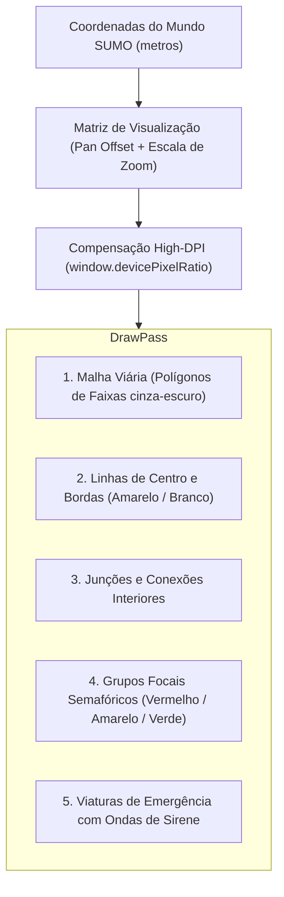

# 🖥️ Interface Desktop & Renderizador Vetorial em HTML5 Canvas

Este documento descreve a arquitetura da interface gráfica do EVP Simulator, desenvolvida com **Wails v2** e renderizada via **HTML5 Canvas 2D** de alta performance em `frontend/app.js`.

⬅️ [Central de Documentação](README.md) | 🏛️ [Arquitetura](architecture.md) | ⚡ [Ponte Wails](wails_ipc_and_bridges.md) | 🗺️ [Parser SUMO](sumo_network_parser.md)

---

## 1. Pipeline de Renderização Vetorial em Canvas 2D

Para garantir fluidez absoluta a **60 FPS** mesmo em malhas urbanas com milhares de faixas e cruzamentos, o renderizador utiliza o padrão de *Transformação Afim Bidimensional* no Canvas nativo:



---

## 2. Controles Interativos de Câmera (Pan & Zoom)

A navegação no mapa espacial é implementada através de manipuladores de eventos de mouse e toque:
- **Arrastar com Botão Esquerdo:** Translada a câmera mantendo o offset vetorial.
- **Roda do Mouse (Wheel):** Aplica fator de zoom centrado na coordenada exata do cursor:

```javascript
canvas.addEventListener('wheel', (e) => {
    e.preventDefault();
    const zoomFactor = e.deltaY < 0 ? 1.15 : 0.85;
    const mouseX = e.offsetX;
    const mouseY = e.offsetY;

    // Converte ponto da tela para coordenadas do mundo
    const worldX = (mouseX - camera.x) / camera.scale;
    const worldY = (mouseY - camera.y) / camera.scale;

    camera.scale *= zoomFactor;
    camera.x = mouseX - worldX * camera.scale;
    camera.y = mouseY - worldY * camera.scale;
    requestRender();
});
```

---

## 3. Animação Visual de Preempção e Sirenes

Quando uma viatura entra em modo de emergência ativa com sirene acionada:
1. Um raio pulsante azul/vermelho é renderizado ao redor da viatura com função senoidal:
   $$R(t) = R_0 + A \cdot \left| \sin(\omega t) \right|$$
2. O cruzamento alvo recebe um anel de destaque indicando a retenção do estágio de onda verde.

---

<div align="center">
  <br/>
  <b>Noxfort Systems</b> — <i>A State Of Art Company</i><br/>
  <i>Engenharia de Mobilidade Inteligente • EVP Simulator v1.0.0</i>
</div>
