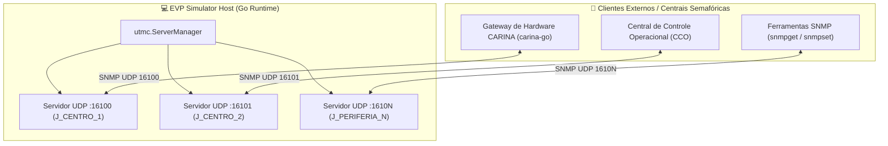

# 🔌 Emulação de Controladores Semafóricos Físicos (SNMP / UTMC2)

Este documento especifica o subsistema de hardware virtual do EVP Simulator, implementado em `internal/infrastructure/utmc/`. O módulo permite emular controladores semafóricos reais de rua comunicando via **SNMP sobre UDP**, reproduzindo protocolos industriais como **UTMC2** e **NTCIP 1202**.

⬅️ [Central de Documentação](README.md) | 🏛️ [Arquitetura](architecture.md) | 🚨 [Walkthrough EVP](evp_walkthrough.md) | 📖 [Referência de APIs](api_and_protocols_reference.md)

---

## 1. Arquitetura do Servidor Agente SNMP em Go

Cada semáforo importado ou associado à malha viária pode ter um servidor UDP SNMP dedicado, orquestrado pelo `ServerManager`:

---

## 2. Catálogo de OIDs Suportadas

O servidor responde às seguintes OIDs padrão de engenharia de tráfego:

| OID | Nome do Objeto | Tipo | Acesso | Descrição |
| :--- | :--- | :---: | :---: | :--- |
| `.1.3.6.1.4.1.1202.1.1.0` | `trafficLightID` | `OCTET STRING` | Read-Only | Identificador da interseção no SUMO. |
| `.1.3.6.1.4.1.1202.1.2.0` | `activePhaseIndex` | `INTEGER` | Read-Only | Índice da fase atualmente aberta (0-based). |
| `.1.3.6.1.4.1.1202.1.3.0` | `phaseDurationSec` | `INTEGER` | Read-Only | Tempo transcorrido na fase atual. |
| `.1.3.6.1.4.1.1202.2.1.0` | `forcePhaseCommand` | `INTEGER` | Read-Write | Comuta imediatamente para a fase solicitada. |
| `.1.3.6.1.4.1.1202.2.2.0` | `preemptionHoldCommand` | `INTEGER` | Read-Write | **1 = Trava fase em verde (EVP)**; **0 = Libera**. |
| `.1.3.6.1.4.1.1202.3.1.0` | `flashingYellowMode` | `INTEGER` | Read-Write | Ativa/desativa alerta intermitente noturno. |

---

## 3. Ciclo de Comutação Segura via UDP

Quando o comando de preempção `preemptionHoldCommand = 1` é recebido:
1. O servidor SNMP valida se a fase requerida é a fase atual.
2. Se a fase atual for conflitante, o controlador virtual aciona o intervalo de segurança de **amarelo (3.5s)** e **vermelho total (1.5s)** antes de assumir o verde contínuo.
3. Um timer de contingência de **45 segundos** é ativado: caso o comando `preemptionHoldCommand = 0` não seja recebido até o timeout, o semáforo encerra o modo prioritário e retoma a programação cíclica normal.

---

   
  <b>Noxfort Systems</b> — <i>A State Of Art Company</i> 
  <i>Engenharia de Mobilidade Inteligente • EVP Simulator v1.0.0</i>
  <small>SPDX-License-Identifier: <a href="../../LICENSE">Apache-2.0</a> • &copy; 2026 Noxfort Systems</small>

