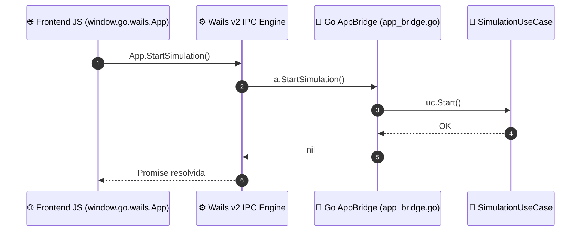

# ⚡ Ponte de Comunicação Wails v2 (Go ↔ JavaScript)

Este documento especifica a camada de integração entre o backend compilado em Go e o frontend desktop em JavaScript, implementada em `internal/infrastructure/wails/app_bridge.go`.

⬅️ [Central de Documentação](README.md) | 🏛️ [Arquitetura](architecture.md) | 🖥️ [Interface Desktop](ui_and_canvas_rendering.md) | 📖 [Referência de APIs](api_and_protocols_reference.md)

---

## 1. Mecanismo de Chamada Remota de Procedimento (RPC)

O Wails v2 gera automaticamente bindings em TypeScript/JavaScript para todos os métodos públicos da struct `App`:



---

## 2. Métodos Exportados pelo `AppBridge`

| Método Go | Parâmetros | Retorno | Descrição |
| :--- | :--- | :--- | :--- |
| `OpenMapDialog()` | `()` | `(string, error)` | Abre caixa nativa do SO para escolher arquivo `.net.xml`. |
| `LoadNetwork(path)` | `path string` | `error` | Inicia o parser e carrega a malha viária na memória. |
| `StartSimulation()` | `()` | `error` | Inicia o loop de ticks em 10 Hz. |
| `PauseSimulation()` | `()` | `error` | Congela a execução física temporariamente. |
| `StepSimulation()` | `()` | `error` | Executa exatamente um passo de $0.1\text{ s}$. |
| `ResetSimulation()` | `()` | `error` | Reinicia veículos para o estado inicial. |
| `SpawnFleet()` | `()` | `error` | Gera frotas de ambulâncias, bombeiros e polícia. |
| `SetVehicleMode(id, m)`| `id string, m string`| `error` | Altera o modo operacional (`Patrol`, `Emergency`). |
| `ExportFleetCSV(path)` | `path string` | `error` | Salva o histórico de telemetria em disco. |

---

## 3. Streaming de Telemetria por Eventos Assíncronos

Para evitar *polling* contínuo do frontend, o Go despacha o estado dos veículos através do barramento de eventos:

```go
// Disparo no Go a cada tick concluído
runtime.EventsEmit(a.ctx, "telemetry_tick", stateDTO)
```

No JavaScript:
```javascript
window.runtime.EventsOn("telemetry_tick", (state) => {
    updateVehiclePositions(state.vehicles);
    updateTrafficLightHeads(state.traffic_lights);
    requestCanvasRepaint();
});
```

---

<div align="center">
  <br/>
  <b>Noxfort Systems</b> — <i>A State Of Art Company</i><br/>
  <i>Engenharia de Mobilidade Inteligente • EVP Simulator v1.0.0</i>
  <small>SPDX-License-Identifier: <a href="../../LICENSE">Apache-2.0</a> • &copy; 2026 Noxfort Systems</small>
</div>
