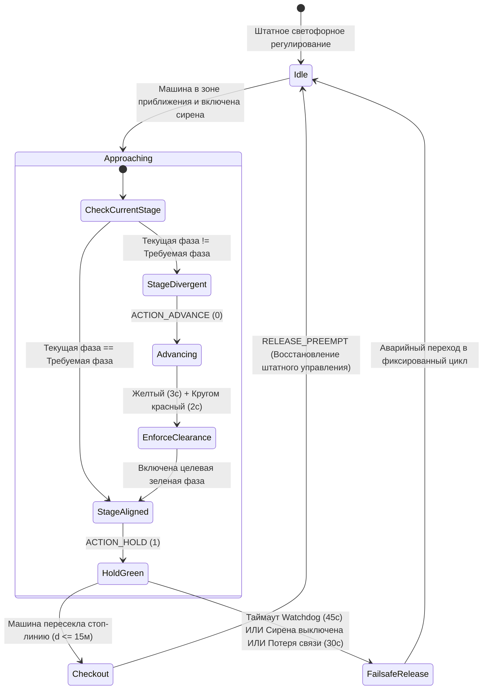

# 🚨 Архитектура приоритетного пропуска спецтранспорта (EVP) и удаленного управления

Данный документ описывает техническую архитектуру подсистемы **приоритетного пропуска спецтранспорта (Emergency Vehicle Preemption — EVP)** CARINA, расположенной в каталоге [`src/evp/`](../../src/evp), высокоскоростного диспетчера преемпции на Go в [`src_go/evp_go/`](../../src_go/evp_go), **веб-шлюза с ячеистой сетью Tailscale Mesh** в [`src_go/web_gateway/`](../../src_go/web_gateway) и **веб-интерфейса карты оператора центра управления (CCO)** в [`src_tsx/src_cco/`](../../src_tsx/src_cco).

⬅️ Назад в [Главный хаб документации](carina_moc.md) | 🏛️ См. [Архитектура системы](architecture.md) | 🛡️ См. [Безопасность и Watchdog](safety_and_watchdog.md) | 🚦 См. [Драйверы оборудования](hardware_drivers.md)

---

## 1. Обзор и нормативно-правовая база

Подсистема приоритетного пропуска спецтранспорта (EVP) обеспечивает детерминированное предоставление приоритетного права проезда в реальном времени («зелёных коридоров») оперативным автомобилям экстренных служб — включая **скорую медицинскую помощь (SAMU)**, **пожарную охрану (Corpo de Bombeiros)** и **полицейские подразделения (Polícia Militar / Civil / Rodoviária)**.

Движок EVP системы CARINA строго соответствует как стандартам безопасности дорожного движения Бразилии (**Резолюция CONTRAN № 960** и **Статья 29, пункт VII Бразильского кодекса дорожного движения — CTB**), так и международным нормативам ИТС (**FHWA MUTCD Раздел 4D.26**):

1. **Законное право проезда при регламентированной безопасности (Ст. 29 CTB):** Приоритет спецтранспорта предоставляется только при одновременной работе звуковой и световой сигнализации (включенная сирена и проблесковые маячки). Даже в режиме приоритетного пропуска промежуточные такты очистки перекрёстка (желтый и всекрасный сигналы) строго выдерживаются для защиты конфликтующего трафика и пешеходов.
2. **Детерминированный двухфакторный триггер:** Запрос на преемпцию формируется исключительно тогда, когда авторизованный автомобиль **находится в пределах расчетного участка подъезда к перекрёстку** ($60\text{ м} \le d \le 160\text{ м}$ или реальная длина квартала сети) **И** у него **активирована звуковая сирена** (`siren_active = True`).
3. **Мгновенное освобождение после проезда (Checkout):** Как только автомобиль экстренных служб пересекает стоп-линию перекрёстка ($d \le 15\text{ м}$ внутри зоны светофорного объекта), режим удержания фазы немедленно сбрасывается без избыточных задержек зеленого сигнала.
4. **Автономный аварийный таймер (Watchdog):** Безусловное ограничение длительности удержания приоритета в 45 секунд предотвращает блокировку магистралей, если спецмашина остановилась, выключила сирену или попала в ДТП.

---

## 2. Высокоуровневая архитектура подсистемы

```mermaid
graph TD
    subgraph Автопарк спецтранспорта
        GPS[GPS-антенна / Мобильное приложение] -->|HTTP POST 204 Fire-and-Forget| WebGW[Веб-шлюз Go порт 2201 / 8085]
    end

    subgraph Слой шлюза на Go (src_go)
        WebGW --> TS[Туннель Tailscale Funnel / VPN Mesh]
        WebGW --> SSE[Хаб рассылки SSE /cco/stream]
        WebGW --> EVP_Go[Диспетчер evp_go]
        WebGW -->|IPC Pipe Строки JSON| GoClient[GoGatewayClient Прокси на Python]
    end

    subgraph Ядро CARINA Core Engine (src/evp)
        GoClient --> EVPSvc[Одиночка EVPService]
        EVPSvc --> FleetMgr[EVPFleetManager и Репозитории]
        EVPSvc --> Kinematics[EVPKinematicsEngine Гаверсинусы WGS84]
        EVPSvc --> PreemptEng[Конечный автомат EVPPreemptionEngine]
        EVPSvc --> TopoSvc[Динамические кварталы EVPTopologyService]
    end

    subgraph Нейро-символический брандмауэр безопасности
        PreemptEng -->|Правило #0 Приоритетный перехват| Auditor[Ядро SafetyAuditor]
        Auditor -->|Контроль желтого и кругом красного| TransitionMgr[StageTransitionManager]
        TransitionMgr -->|Команды HOLD или ADVANCE| HardwareMgr[Полевые контроллеры NTCIP/UTMC]
    end

    subgraph Панели операторов
        SSE --> CCO[Веб-карта CCO React/TSX src_tsx]
        EVPSvc -->|Шина событий в ОЗУ| FletUI[Десктопный GUI Flet ui/cards/ и ui/widgets/]
    end
```

---

## 3. Доменная модель и сущности (`src/evp/evp_models.py`)

Доменная модель EVP инкапсулирует идентификацию транспортных средств, реестр муниципального автопарка и кинематическую телеметрию:

### 3.1 Классификация оперативных служб (`CorporationType`)

| Служба | Код | Фигура на карте UI | Базовый цвет | Цвет при сирене | Приоритет конфликта |
| :--- | :---: | :---: | :---: | :---: | :---: |
| **Скорая помощь (SAMU)** | `SAMU` | Треугольник ($\Delta$) | Белый (`#FFFFFF`) | Ярко-красный (`#E53935`) | Приоритет 1 (Жизнь и здоровье) |
| **Пожарная охрана** | `BOMBEIRO` | Квадрат ($\square$) | Янтарный (`#FF8C00`) | Огненно-оранжевый (`#FF3D00`) | Приоритет 1 (Жизнь и здоровье) |
| **Полиция (Гражданская / Военная)** | `POLICIA` | Круг ($\bigcirc$) | Темно-синий (`#1E3A8A`) | Королевский синий (`#2563EB`) | Приоритет 2 (Общественный порядок) |

### 3.2 Сущность зарегистрированного автомобиля (`RegisteredVehicle`)
Отражает служебный автомобиль, официально допущенный к взаимодействию с платформой CARINA:
- `vehicle_id` (например, `"SAMU-01"`): Уникальный буквенно-цифровой идентификатор борта.
- `corporation`: Принадлежность к службе `CorporationType`.
- `plate`: Государственный регистрационный номерной знак.
- `ip_address` / `port`: Сетевые реквизиты бортового оборудования передачи данных.
- `auth_token`: Опциональный криптографический токен аутентификации пакетов телеметрии.
- `is_active`: Флаг административного допуска к системе.

### 3.3 Динамический корень агрегата (`EmergencyVehicle`)
Инкапсулирует телеметрию реального времени, пространственные координаты и текущее состояние преемпции:
- Геолокация: `latitude`, `longitude`, `speed_kmh`, `heading_deg`.
- Рабочий режим: `siren_active` (булево значение).
- Состояние преемпции: `is_evp_triggered`, `active_intersection_id`, `active_intersections` (множество ID), `dwell_start_time`.
- Статус соединения: `is_online`, оцениваемый относительно `offline_timeout_seconds` (по умолчанию: $30.0\text{ с}$).

---

## 4. Геодезическая кинематика и пространственное обнаружение (`src/evp/evp_kinematics.py`)

Геодезические расстояния рассчитываются по **формуле гаверсинусов (Haversine Formula)** на земном эллипсоиде WGS84 ($R = 6,371,000\text{ м}$):

$$\Delta\phi = \text{radians}(\phi_2 - \phi_1), \quad \Delta\lambda = \text{radians}(\lambda_2 - \lambda_1)$$

$$a = \sin^2\left(\frac{\Delta\phi}{2}\right) + \cos(\phi_1)\cos(\phi_2)\sin^2\left(\frac{\Delta\lambda}{2}\right)$$

$$c = 2 \cdot \text{atan2}\left(\sqrt{a}, \sqrt{1 - a}\right), \quad d = R \cdot c$$

```text
 Входные ворота квартала приближения                 Стоп-линия перекрёстка
  (60м <= d <= 160м)                                  (Выезд: d <= 15м)
─────────┬─────────────────────────────────────────────────────┬─────────►
         │ <───────────── Зона приближения ──────────────────> │
    Въезд машины                                          Машина проехала
    Запуск преемпции                                      Сброс преемпции
    (если siren_active=True)                              (Мгновенный возврат к норме)
```

### 4.1 Условие входа в зону перекрёстка (`is_at_block_entrance`)
- Оценивает, удовлетворяет ли расстояние до перекрёстка критерию:
  
  $$d_{\text{min}} \le d_{\text{vehicle}} \le d_{\text{max}}$$
  
  Где $d_{\text{min}} = 60.0\text{ м}$ и $d_{\text{max}} = 160.0\text{ м}$ (или реальная длина дорожного сегмента $L_{\text{quadra}}$, полученная из [`EVPTopologyService`](../../src/evp/evp_topology_service.py)).

### 4.2 Фиксация проезда перекрёстка (`has_checked_out`)
- Когда $d_{\text{vehicle}} \le 15.0\text{ м}$ и вектор движения направлен за стоп-линию, движок преемпции выполняет атомарный выезд (checkout), снимая фиксацию зеленого сигнала.

---

## 5. Конечный автомат и жизненный цикл преемпции (`src/evp/evp_preemption_engine.py`)

Конечный автомат преемпции управляет переходами между фазами светофора без нарушения нормативных межзеленых интервалов безопасности:



### 5.1 Команды управления преемпцией
- **`ACTION_HOLD` (1):** Удерживается, когда текущая фаза контроллера совпадает с фазой коридора экстренного проезда (`target_stage`). Запрещает локальному контроллеру завершать зеленый сигнал до фиксации проезда спецмашины.
- **`ACTION_ADVANCE` (0):** Подается, когда контроллер находится в конфликтующей фазе. Инициирует немедленный переход к целевой фазе через нормативные интервалы желтого и всекрасного сигналов.

### 5.2 Защитные таймеры Watchdog и аварийные сбросы
1. **Максимальное удержание по CONTRAN ($45.0\text{ с}$):** Если преемпция активна более 45 с на одном перекрёстке, она безусловно сбрасывается для пропуска накопившегося поперечного потока.
2. **Таймаут потери связи ($30.0\text{ с}$):** Если телеметрия от машины не поступает $> 30\text{ с}$, автомобиль помечается как офлайн, а удержание снимается.
3. **Отключение сирены:** Если водитель отключает сирену (`siren_active = False`), «зелёный коридор» немедленно деактивируется.

---

## 6. Интеграция с ядром аудита безопасности (`SafetyAuditor`)

В модуле [`src/core/safety_auditor.py`](../../src/core/safety_auditor.py) приоритет EVP обрабатывается как **Правило #0 (Приоритетный перехват экстренных служб)** до вычисления предложений нейросети или символических правил SR-01—SR-05:

```python
# 0. Emergency Priority Interception (EVP - Emergency Vehicle Preemption)
try:
    from src.evp.evp_bridge import EVPBridge
    bridge = EVPBridge()
    evp_action, is_evp, _ = bridge.intercept_safety_audit(
        tl_id=tl_id,
        current_stage=current_stage_idx,
        stage_duration=current_stage_duration,
        suggested_action=suggested_action,
    )
    if is_evp and evp_action is not None:
        if evp_action == 1:
            self.last_veto_reasons[tl_id] = "Preempção de Veículo de Emergência (EVP - Corredor Verde Ativo)"
        return evp_action, (evp_action == 1)
except Exception:
    pass
```

---

## 7. Высокопроизводительный аппаратный диспетчер (`src_go/evp_go/`)

Скомпилированный бинарный файл на Go (`bin/carina-go`) обеспечивает микросекундную передачу команд удержания контроллерам по протоколам NTCIP 1202 и UTMC2:

### 7.1 Маршрутизация команд диспетчера (`dispatcher.go`)
- Принимает пакеты команд `PreemptionCommand` от системного маршрутизатора.
- `activate_preempt`: Записывает битовые маски OID `ascPhaseHold` по протоколу SNMP через UDP-порт 161.
- `release_preempt`: Сбрасывает битовые маски удержания фаз, возвращая управление адаптивному алгоритму или локальным суточным планам контроллера.

---

## 8. Веб-шлюз и удаленное подключение (`src_go/web_gateway/`)

Веб-шлюз на Go обслуживает внешние эндпоинты приема бортовой телеметрии и интерфейсы операторов:

```text
                  TAILSCALE FUNNEL (Порт 2201 / HTTPS)
                   (Защищенный публичный/приватный доступ)
                                │
               ┌────────────────┴────────────────┐
               ▼                                 ▼
      /api/v1/evp/telemetry                  /cco/stream
   (GPS-антенны спецтранспорта)       (Видеостены операторов CCO)
   - HTTP POST (Fire-and-Forget)      - Server-Sent Events (SSE)
   - HTTP 204 No Content              - Живые кадры JSON-телеметрии
```

### 8.1 Однонаправленный прием координат GPS (`handlers_evp.go`)
- **Маршрут:** `POST /api/v1/evp/telemetry` (и `/amb`)
- **Код ответа:** `204 No Content`
- **Задержка обработки:** $< 0.5\text{ мс}$
- **Схема полезной нагрузки:**
  ```json
  {
    "vehicle_id": "SAMU-01",
    "corporation": "SAMU",
    "latitude": -23.31028,
    "longitude": -51.16278,
    "speed_kmh": 68.5,
    "heading_deg": 182.0,
    "siren_active": true,
    "timestamp": 1789458600.0
  }
  ```

### 8.2 Интеграция с Tailscale Funnel (`tailscale.go`)
- Обеспечивает зашифрованное туннелирование с нулевой конфигурацией прямо со шлюза без открытия входящих портов на муниципальных роутерах.
- Автоматически запрашивает статус узла через локальные IPC-сокеты Tailscale для динамического формирования публичных URL-адресов CCO.

---

## 9. Веб-интерфейс оператора центра управления (CCO) (`src_tsx/src_cco/`)

Информативная оперативная видеостена, построенная на **React 18**, **TypeScript**, **Tailwind CSS** и **ECharts**:

- **Подписка на поток SSE в реальном времени:** Сервис [`SseCcoStreamService.ts`](../../src_tsx/src_cco/infrastructure/stream/SseCcoStreamService.ts) подключается к `/cco/stream`, принимая кадры без опроса по таймеру (polling).
- **Векторные SVG-слои карты:**
  - `MapRoadsLayer.tsx`: Дорожные сегменты с цветовой кодировкой плотности заторов.
  - `MapTrafficLightsLayer.tsx`: Индикация текущих сигналов светофорных объектов.
  - `MapEmergencyVehiclesLayer.tsx`: Пульсирующие геометрические маркеры спецслужб.
- **Система алертов:** Компонент [`EvpAlertToast.tsx`](../../src_tsx/src_cco/presentation/components/EvpAlertToast.tsx) отображает баннеры при активации приоритетного коридора.
- **Инспектор транспорта:** Карточка [`VehicleInspectionCard.tsx`](../../src_tsx/src_cco/presentation/components/map/VehicleInspectionCard.tsx) отображает скорость, курс и статус преемпции при клике на машину.

---

## 10. Интеграция с десктопным интерфейсом Flet (`ui/`)

Нативный интерфейс CARINA на Flet включает специализированные элементы управления EVP:

### 10.1 Карточки настроек (`ui/cards/`)
- **`EVPFleetConnectionCard` (`evp_fleet_connection_card.py`):**
  - Таблица зарегистрированных спецмашин в реальном времени.
  - Инструмент импорта/экспорта CSV для обновления парка.
  - Индикаторы статуса (Активен / Неактивен, В сети / Не в сети).
- **`EVPSafetyParametersCard` (`evp_safety_parameters_card.py`):**
  - Настройка расстояния входа в зону перекрёстка ($60\text{--}160\text{ м}$).
  - Предельное время удержания фазы watchdog ($15\text{--}120\text{ с}$).
  - Переключатель авторегистрации неизвестных бортов.

### 10.2 Виджеты холста карты (`ui/widgets/`)
- **`EVPVehicleMarker` (`evp_vehicle_marker.py`):** Векторный рендеринг на холсте с пульсирующей анимацией, управляемой [`MapAnimator`](../../ui/animators/map_animator.py).
- **`EVPVehicleCard` (`evp_vehicle_card.py`):** Всплывающая карточка инспекции параметров борта.

---

## 11. Схемы реляционной базы данных

Данные регистрации транспорта и история телеметрии сохраняются в PostgreSQL / SQLite:

### 11.1 Таблица: `evp_registered_fleet`
```sql
CREATE TABLE IF NOT EXISTS evp_registered_fleet (
    vehicle_id VARCHAR(64) PRIMARY KEY,
    corporation VARCHAR(32) NOT NULL,
    plate VARCHAR(16),
    description VARCHAR(128),
    device_id VARCHAR(64),
    ip_address VARCHAR(45),
    port INT DEFAULT 8085,
    protocol VARCHAR(16) DEFAULT 'HTTP',
    auth_token VARCHAR(128),
    is_active BOOLEAN DEFAULT TRUE,
    created_at TIMESTAMP DEFAULT CURRENT_TIMESTAMP
);
```

### 11.2 Таблица: `evp_telemetry_records`
```sql
CREATE TABLE IF NOT EXISTS evp_telemetry_records (
    id BIGSERIAL PRIMARY KEY,
    vehicle_id VARCHAR(64) NOT NULL,
    corporation VARCHAR(32) NOT NULL,
    latitude DOUBLE PRECISION NOT NULL,
    longitude DOUBLE PRECISION NOT NULL,
    speed_kmh REAL NOT NULL,
    heading_deg REAL NOT NULL,
    siren_active BOOLEAN NOT NULL,
    evp_triggered BOOLEAN NOT NULL DEFAULT FALSE,
    intersection_id VARCHAR(64),
    created_at TIMESTAMP DEFAULT CURRENT_TIMESTAMP
);

CREATE INDEX idx_evp_veh_time ON evp_telemetry_records (vehicle_id, created_at DESC);
```

### 11.3 Таблица: `evp_denied_fleet`
```sql
CREATE TABLE IF NOT EXISTS evp_denied_fleet (
    vehicle_id VARCHAR(64) PRIMARY KEY,
    denied_at TIMESTAMP DEFAULT CURRENT_TIMESTAMP
);
```

---

## 12. Верификация и тестирование

### 12.1 Набор автоматизированных тестов Pytest
Подсистема EVP покрыта 12 специализированными модулями модульного тестирования в каталоге `tests/unit/`:
```bash
pytest tests/unit/test_evp_*.py -v
```

Ключевые тестовые модули:
- `test_evp_service.py`: Двухфакторный триггер, оценка действий по CONTRAN, смены состояний.
- `test_evp_kinematics.py`: Геодезические расстояния, пороги входных ворот, границы checkout.
- `test_evp_preemption_engine.py`: Удержание зелёного коридора, истечение таймера watchdog, аварийный сброс.
- `test_evp_fleet_persistence.py` и `test_evp_fleet_csv.py`: Операции CRUD базы данных и синхронизация CSV.

### 12.2 Автономный симулятор спецтранспорта CLI (`demo/evp_vehicle_simulator.py`)
Для имитации движения оперативных автомобилей во время работы системы CARINA:
```bash
# Режим экстренного вызова с включенной сиреной (SAMU-01)
python demo/evp_vehicle_simulator.py --vehicle SAMU-01 --mode emergency

# Режим патрулирования для смешанного парка (Скорая, Пожарные, Полиция)
python demo/evp_vehicle_simulator.py --mode patrol --duration 60
```

---

<div align="center">
  <br/>
  <b>Noxfort Systems</b> — <i>A State Of Art Company</i><br/>
  <i>Инженерия Интеллектуальной Мобильности • CARINA CORE v1.2.0</i><br/>
  <small>© 2026 Noxfort Systems. Лицензия AGPLv3.</small>
</div>
