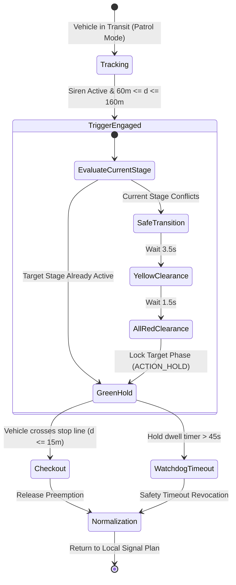

# 🚨 Техническое руководство по приоритету спецтранспорта (EVP)

This document specifies the **Emergency Vehicle Preemption (EVP)** algorithms implemented in the EVP Simulator. The architecture strictly adheres to Brazilian traffic safety regulations (**CONTRAN Resolution nº 960**, **Art. 29, Section VII of the Brazilian Traffic Code - CTB**) and international standards (**FHWA MUTCD Section 4D.26**).

⬅️ [Центр документации](README.md) | 🏛️ [Architecture](architecture.md) | 🚗 [Kinematics](kinematics_and_routing.md) | 🛡️ [Safety](signal_evaluation_and_safety.md)

---

## 1. Regulatory Right-of-Way Principles

Under **Art. 29, VII of the CTB**, emergency vehicles (ambulances, fire engines, police patrols) possess right-of-way **only when in urgent mission status and actively displaying continuous optical (flashing beacons) and audible (siren) warning signals**.

EVP Simulator enforces this via a **Deterministic Two-Factor Trigger**:
1. **Spatial In-Block Criterion:** The emergency vehicle must be positioned within the approach detection zone ($60\text{ m} \le d \le 160\text{ m}$).
2. **Operational Siren Criterion:** The vehicle's audible siren must be actively engaged (`SirenActive == true`).

---

## 2. Preemption Lifecycle State Machine



---

## 3. Spatial Zone Delimitation

```text
                               Intersection Stop-Line
       Advance Zone                 EVP Trigger Zone             Checkout
    [> 160m to Junction]           [60m <= d <= 160m]           [d <= 15m]
────────────────────────────┬─────────────────────────────┬────────────────────┼──── Intersection
   Kinematic Tracking Only  │  Issue Preemption Request   │ Release Priority   │
   No Phase Alteration      │  Transition to Green Hold   │ Resume Plan        │
────────────────────────────┴─────────────────────────────┴────────────────────┴────
```

### 3.1 Kinematic Approach Distance
The Euclidean distance $d$ between vehicle coordinates $(x_v, y_v)$ and the junction stop line $(x_j, y_j)$ is computed as:

$$d = \sqrt{(x_j - x_v)^2 + (y_j - y_v)^2}$$

Estimated Time-to-Clearance (TTC) is updated using instantaneous vehicle speed $v$:

$$\text{TTC} = \frac{d}{v}$$

When $\text{TTC} \le 8\text{ s}$ and the vehicle is in a designated lane connecting to the target stage, preemption transition is commanded.

### 3.2 45-Second Watchdog Fail-Safe
To prevent permanent network deadlock if an emergency vehicle stops, turns off its siren, or crashes inside the preemption zone, the controller maintains an unconditional **45-second dwell watchdog timer**. Upon expiration, preemption is revoked and local control resumes.

---

<div align="center">
  <br/>
  <b>Noxfort Systems</b> — <i>A State Of Art Company</i><br/>
  <i>Инженерия интеллектуальной мобильности • EVP Simulator v1.0.0</i>
  <small>SPDX-License-Identifier: <a href="../../LICENSE">Apache-2.0</a> • &copy; 2026 Noxfort Systems</small>
</div>
