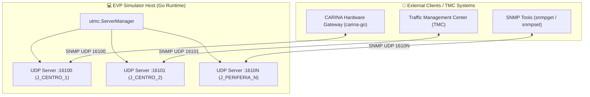

# 🔌 Эмуляция физических дорожных контроллеров (SNMP / UTMC2)

This document specifies the virtual hardware subsystem implemented in `internal/infrastructure/utmc/`. The module emulates real-world traffic controllers communicating over **SNMP via UDP** adhering to **UTMC2** and **NTCIP 1202** specifications.

⬅️ [Центр документации](README.md) | 🏛️ [Architecture](architecture.md) | 🚨 [EVP Walkthrough](evp_walkthrough.md) | 📖 [API Reference](api_and_protocols_reference.md)

---

## 1. Go UDP SNMP Agent Architecture

Each emulated traffic light runs an independent UDP SNMP agent managed by `ServerManager`:

---

## 2. Supported OID Catalog

| OID | Object Name | Type | Access | Описание |
| :--- | :--- | :---: | :---: | :--- |
| `.1.3.6.1.4.1.1202.1.1.0` | `trafficLightID` | `OCTET STRING` | Read-Only | Junction identifier in SUMO network. |
| `.1.3.6.1.4.1.1202.1.2.0` | `activePhaseIndex` | `INTEGER` | Read-Only | Index of currently active stage (0-based). |
| `.1.3.6.1.4.1.1202.1.3.0` | `phaseDurationSec` | `INTEGER` | Read-Only | Elapsed duration in active stage. |
| `.1.3.6.1.4.1.1202.2.1.0` | `forcePhaseCommand` | `INTEGER` | Read-Write | Force transition to requested phase index. |
| `.1.3.6.1.4.1.1202.2.2.0` | `preemptionHoldCommand` | `INTEGER` | Read-Write | **1 = Lock green stage (EVP)**; **0 = Release**. |
| `.1.3.6.1.4.1.1202.3.1.0` | `flashingYellowMode` | `INTEGER` | Read-Write | Enable/disable overnight flashing yellow. |

---

## 3. Safe State Transition Sequence

Upon receiving `preemptionHoldCommand = 1`:
1. If the current phase conflicts with the requested preemption movement, mandatory yellow change (3.5s) and all-red clearance (1.5s) intervals are enforced.
2. An autonomous **45-second watchdog timer** guards against orphaned preemption commands.

---

   
  <b>Noxfort Systems</b> — <i>A State Of Art Company</i> 
  <i>Инженерия интеллектуальной мобильности • EVP Simulator v1.0.0</i>

