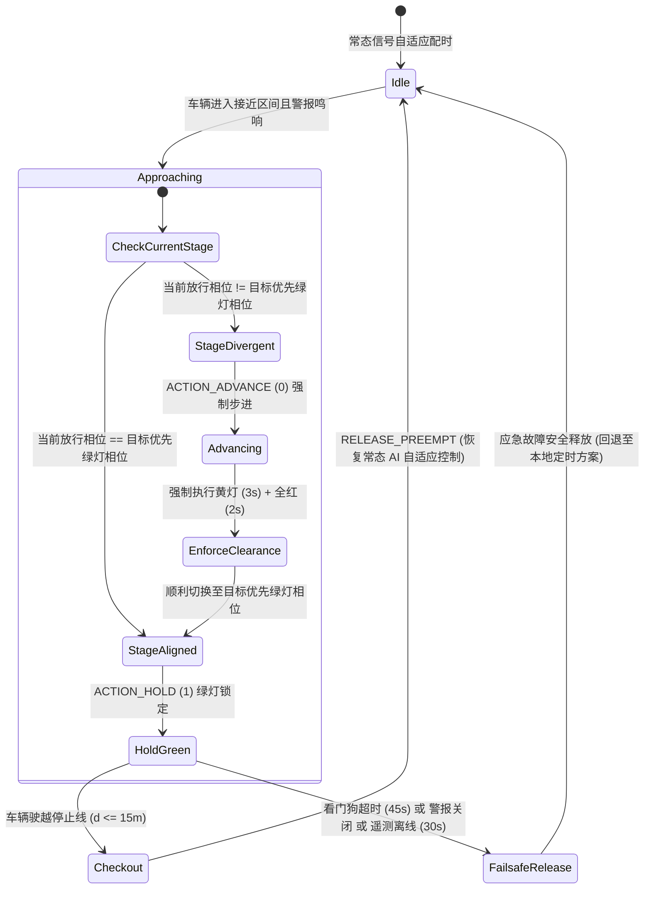

# 🚨 应急车辆优先通行 (EVP) 与远程调度指挥架构

本文档详尽规范了 CARINA **应急车辆优先通行 (Emergency Vehicle Preemption, EVP)** 子系统的工程架构，涵盖位于 [`src/evp/`](../../src/evp) 的核心控制逻辑、位于 [`src_go/evp_go/`](../../src_go/evp_go) 的微秒级 Go 语言硬件优先调度器、位于 [`src_go/web_gateway/`](../../src_go/web_gateway) 的 **基于 Tailscale 虚拟网格的 Web 网关**，以及位于 [`src_tsx/src_cco/`](../../src_tsx/src_cco) 的 **中央控制调度中心 (CCO) 现代化大屏地图系统**。

⬅️ 返回 [核心技术主文档中心 (MOC)](carina_moc.md) | 🏛️ 查阅 [系统架构](architecture.md) | 🛡️ 查阅 [安全机制与看门狗](safety_and_watchdog.md) | 🚦 查阅 [硬件驱动程序](hardware_drivers.md)

---

## 1. 概述与交通法规标准

应急车辆优先通行 (EVP) 子系统旨在为执行紧急任务的特种特勤车辆（包括 **SAMU** 移动急救医疗车、**消防车** (Corpo de Bombeiros) 以及 **警车** (Polícia Militar / Civil / Rodoviária)）实时、确定性地开辟信号优先通行权（全绿波生命通道）。

CARINA 的 EVP 优先控制引擎严格遵循巴西交通法规标准（**CONTRAN 第 960 号决议** 与 **巴西交通法典 CTB 第 29 条第 VII 款**）以及国际智能交通系统规范（**FHWA MUTCD 第 4D.26 节**）：

1. **法定优先通行权与安全规范（CTB 第 29 条）：** 优先通行权的激活必须同时具备声光警报装置（警报器鸣响与警灯闪烁）。即使在强行插队优先控制下，也必须严格强制执行黄灯及全红清空安全间隔，以绝对保障冲突相位车辆与行人的生命安全。
2. **确定性双因子触发机制：** 只有当已授权车辆**在物理空间上处于目标路口进入街区范围内**（$60\text{ m} \le d \le 160\text{ m}$ 或实际物理街区拓扑长度）**且**车载**听觉警报器处于鸣响激活状态**（`siren_active = True`）时，系统才会受理优先通行请求。
3. **驶离即刻解除机制 (Checkout Clearance)：** 一旦应急特种车辆驶越交叉口停止线（驶入交叉口内部 $d \le 15\text{ m}$），优先控制权即刻无缝释放，杜绝无效绿灯时间浪费。
4. **自主看门狗故障安全保护：** 强制实施 45 秒最大优先驻留时间限制。若应急车辆在路口前驻停、关闭警报或发生故障，超时后系统将无条件强制释放控制权，彻底防止交叉方向道路发生大面积网状锁死。

---

## 2. 子系统宏观架构拓扑

```mermaid
graph TD
    subgraph 车队前端感知
        GPS[车载高精 GPS 天线 / 移动端 App] -->|HTTP POST 204 即发即弃| WebGW[Go Web 网关 端口 2201 / 8085]
    end

    subgraph Go 语言网关层 (src_go)
        WebGW --> TS[Tailscale Funnel / VPN 网格隧道]
        WebGW --> SSE[SSE 广播发布中心 /cco/stream]
        WebGW --> EVP_Go[evp_go 优先调度器]
        WebGW -->|IPC 管道逐行 JSON| GoClient[GoGatewayClient Python 代理]
    end

    subgraph CARINA 核心控制引擎 (src/evp)
        GoClient --> EVPSvc[EVPService 核心单例服务]
        EVPSvc --> FleetMgr[EVPFleetManager 车队管理与仓储]
        EVPSvc --> Kinematics[EVPKinematicsEngine 空间运动学]
        EVPSvc --> PreemptEng[EVPPreemptionEngine 优先状态机]
        EVPSvc --> TopoSvc[EVPTopologyService 动态拓扑服务]
    end

    subgraph 神经符号安全防火墙
        PreemptEng -->|规则 #0 最高优先级拦截| Auditor[SafetyAuditor 安全审计核心]
        Auditor -->|强制黄灯与全红安全清空| TransitionMgr[StageTransitionManager 相位过渡管理器]
        TransitionMgr -->|下发 HOLD 保持或 ADVANCE 步进| HardwareMgr[物理交通机 NTCIP/UTMC]
    end

    subgraph 调度运维指挥大屏
        SSE --> CCO[CCO Web 大屏 React/TSX src_tsx]
        EVPSvc -->|内存事件总线| FletUI[Flet 桌面客户端 ui/cards/ 与 ui/widgets/]
    end
```

---

## 3. 领域模型与核心实体 (`src/evp/evp_models.py`)

EVP 领域模型封装了特种车辆标识、市政特勤车队资质授权以及空间运动学遥测数据：

### 3.1 机构分类枚举 (`CorporationType`)

| 所属机构 | 机构编码 | 前端图元形状 | 常规状态色彩 | 警报激活色彩 | 冲突仲裁优先级 |
| :--- | :---: | :---: | :---: | :---: | :---: |
| **急救中心 (SAMU)** | `SAMU` | 三角形 ($\Delta$) | 纯白 (`#FFFFFF`) | 鲜艳红 (`#E53935`) | 优先级 1（生命救援最高优先） |
| **消防局 (Bombeiros)** | `BOMBEIRO` | 正方形 ($\square$) | 琥珀黄 (`#FF8C00`) | 烈火橙 (`#FF3D00`) | 优先级 1（生命救援最高优先） |
| **警察局 (Civil / PM)** | `POLICIA` | 圆形 ($\bigcirc$) | 深蓝 (`#1E3A8A`) | 皇家蓝 (`#2563EB`) | 优先级 2（治安秩序维护） |

### 3.2 注册车队实体 (`RegisteredVehicle`)
代表经市政交通管理部门官方认证授权接入 CARINA 系统的特勤车辆：
- `vehicle_id`（如 `"SAMU-01"`）：车队中全局唯一的字母数字标识。
- `corporation`：所属特勤机构类型 `CorporationType`。
- `plate`：机动车法定号牌。
- `ip_address` / `port`：车载通信终端的底层网络参数。
- `auth_token`：用于防止遥测伪造攻击的机密校验令牌。
- `is_active`：管理层授权状态启闭开关。

### 3.3 动态聚合根实体 (`EmergencyVehicle`)
封装实时遥测位置、空间几何状态以及优先通行生命周期：
- 地理位置参数：`latitude`（纬度）、`longitude`（经度）、`speed_kmh`（瞬时速度）、`heading_deg`（航向角）。
- 运行工况状态：`siren_active`（警报器是否处于鸣响状态）。
- 优先控制状态：`is_evp_triggered`、`active_intersection_id`、`active_intersections`（活动路口集合）、`dwell_start_time`（驻留计时起始点）。
- 连接保活状态：基于 `offline_timeout_seconds`（默认：$30.0\text{ s}$）计算的 `is_online` 在线状态。

---

## 4. 大地测地学运动学与空间进入判定 (`src/evp/evp_kinematics.py`)

系统基于 WGS84 参考椭球体模型（地球半径 $R = 6,371,000\text{ m}$），采用 **Haversine 公式** 计算高精度测地距离：

$$\Delta\phi = \text{radians}(\phi_2 - \phi_1), \quad \Delta\lambda = \text{radians}(\lambda_2 - \lambda_1)$$

$$a = \sin^2\left(\frac{\Delta\phi}{2}\right) + \cos(\phi_1)\cos(\phi_2)\sin^2\left(\frac{\Delta\lambda}{2}\right)$$

$$c = 2 \cdot \text{atan2}\left(\sqrt{a}, \sqrt{1 - a}\right), \quad d = R \cdot c$$

```text
 接近街区进入判定门限                                路口停车线
  (60m <= d <= 160m)                                  (驶离判定: d <= 15m)
─────────┬─────────────────────────────────────────────────────┬─────────►
         │ <────────────── 优先触发评估区间 ─────────────────> │
    车辆驶入进入门限                                      车辆跨越停止线
    激活绿波优先控制                                      瞬间解除优先控制
    (需同时满足 siren_active=True)                       (无缝平滑回退常态控制)
```

### 4.1 街区进入触发判定 (`is_at_block_entrance`)
- 判定车辆与目标路口的空间几何距离是否严格落在准入区间：
  
  $$d_{\text{min}} \le d_{\text{vehicle}} \le d_{\text{max}}$$
  
  其中标准参数 $d_{\text{min}} = 60.0\text{ m}$，$d_{\text{max}} = 160.0\text{ m}$（若配置了 [`EVPTopologyService`](../../src/evp/evp_topology_service.py)，则自适应使用该路段真实的物理拓扑长度 $L_{\text{quadra}}$）。

### 4.2 驶离路口判定 (`has_checked_out`)
- 当 $d_{\text{vehicle}} \le 15.0\text{ m}$ 且轨迹向量显示车辆已越过物理停止线进入交叉口展宽区内部，优先控制引擎执行原子级驶离注销操作，瞬间撤销该交叉口的绿灯锁定。

---

## 5. 优先控制状态机与全生命周期 (`src/evp/evp_preemption_engine.py`)

优先控制状态机在确保不破坏任何法定红黄绿过渡安全间隔的前提下，协调交通机相位的平滑跳转与锁定：



### 5.1 优先控制决策动作
- **`ACTION_HOLD` (1)：** 当现场物理交通机当前放行相位与应急优先通道（`target_stage`）一致时保持下发。禁止现场控制器擅自切断绿灯，直至车辆完全驶离路口。
- **`ACTION_ADVANCE` (0)：** 当现场交通机处于冲突相位时下发。向信号机请求立即步进切换，强制进入黄灯及全红安全清空过渡时序。

### 5.2 法规级看门狗与故障安全时钟
1. **CONTRAN 最大驻留超时限制 ($45.0\text{ s}$)：** 单一交叉口连续执行优先绿灯保持的最长时间严禁超过 $45\text{ s}$。一旦超时无条件强行终止，以快速疏导交叉方向积压的社会车流。
2. **车辆数据离线超时 ($30.0\text{ s}$)：** 若连续超过 $30\text{ s}$ 未收到该特勤车辆的心跳遥测帧，判定通信中断，自动注销其优先特权。
3. **车载警报关闭：** 驾驶员一旦主动关闭听觉警报器（`siren_active = False`），绿波走廊瞬间解除。

---

## 6. 与核心神经符号安全审计器的集成 (`SafetyAuditor`)

在 [`src/core/safety_auditor.py`](../../src/core/safety_auditor.py) 中，EVP 优先通行逻辑被提升为 **规则 #0（最高优先权应急拦截规则）**，先于任何深度神经网络提议或 SR-01 至 SR-05 符号安全规则执行：

```python
# 0. Emergency Priority Interception (EVP - Emergency Vehicle Preemption)
try:
    from src.evp.evp_bridge import EVPBridge
    bridge = EVPBridge()
    evp_action, is_evp, _ = bridge.intercept_safety_audit(
        tl_id=tl_id,
        current_stage=current_stage_idx,
        stage_duration=current_stage_duration,
        suggested_action=suggested_action,
    )
    if is_evp and evp_action is not None:
        if evp_action == 1:
            self.last_veto_reasons[tl_id] = "Preempção de Veículo de Emergência (EVP - Corredor Verde Ativo)"
        return evp_action, (evp_action == 1)
except Exception:
    pass
```

---

## 7. 高性能编译型硬件调度器 (`src_go/evp_go/`)

由 Go 语言编译生成的原生二进制文件（`bin/carina-go`）负责向 NTCIP 1202 与 UTMC2 交通机执行微秒级优先锁定指令下发：

### 7.1 调度器指令路由与执行 (`dispatcher.go`)
- 接收来自网关路由器的 `PreemptionCommand` 调度封包。
- `activate_preempt`：通过 UDP 161 端口向现场交通机注入 `ascPhaseHold` OID 物理保持位掩码。
- `release_preempt`：即刻清除相应相位的保持位掩码，将控制权无缝归还给本地自主感应控制或周期循环计时器。

---

## 8. Web 网关与安全远程网络连接 (`src_go/web_gateway/`)

Go Web 网关同时对外暴露用于车载终端遥测接入的端点以及面向大屏指挥的浏览器流式端点：

```text
                  TAILSCALE FUNNEL (端口 2201 / HTTPS)
                   (安全可靠的公共/私有安全网格通道)
                                │
               ┌────────────────┴────────────────┐
               ▼                                 ▼
      /api/v1/evp/telemetry                  /cco/stream
   (车载高精 GPS 遥测接入)                 (浏览器监控调度大屏)
   - HTTP POST（即发即弃高吞吐）          - 服务器发送事件 (SSE)
   - HTTP 204 No Content 零载荷回包      - 实时毫秒级 JSON 遥测帧
```

### 8.1 单向轻量级 GPS 遥测摄入 (`handlers_evp.go`)
- **API 路由：** `POST /api/v1/evp/telemetry`（兼容 `/amb`）
- **状态回包：** `204 No Content`
- **摄入处理延迟：** $< 0.5\text{ ms}$
- **数据载荷格式：**
  ```json
  {
    "vehicle_id": "SAMU-01",
    "corporation": "SAMU",
    "latitude": -23.31028,
    "longitude": -51.16278,
    "speed_kmh": 68.5,
    "heading_deg": 182.0,
    "siren_active": true,
    "timestamp": 1789458600.0
  }
  ```

### 8.2 Tailscale Funnel 虚拟网格穿透集成 (`tailscale.go`)
- 无需在市政边缘机房路由器上开放任何入站公网端口，即可直接建立端到端加密的零信任安全隧道。
- 通过 Tailscale 本地 IPC 管道自动查询节点运行状态，动态生成用于远程指挥访问的 CCO 安全公网 URL。

---

## 9. 中央控制调度中心 (CCO) Web 大屏前端 (`src_tsx/src_cco/`)

专为市政交通运营指挥大屏打造的高信息密度可视化系统，基于 **React 18**、**TypeScript**、**Tailwind CSS** 与 **Apache ECharts** 构建：

- **实时 SSE 数据流订阅：** [`SseCcoStreamService.ts`](../../src_tsx/src_cco/infrastructure/stream/SseCcoStreamService.ts) 建立与 `/cco/stream` 的长连接，无需轮询即可毫秒级消费全城最新动态帧。
- **高性能矢量 SVG 地图图层：**
  - `MapRoadsLayer.tsx`：根据道路瞬时饱和度渲染路网连通走廊。
  - `MapTrafficLightsLayer.tsx`：实时渲染各交叉口信号灯头亮灯倒计时。
  - `MapEmergencyVehiclesLayer.tsx`：高亮闪烁渲染特勤机构专属几何图元标记。
- **优先通行警报浮窗：** [`EvpAlertToast.tsx`](../../src_tsx/src_cco/presentation/components/EvpAlertToast.tsx) 一旦检测到绿波生命通道触发，立即在 HUD 抬头显示区弹出全局视听警告横幅。
- **车载终端诊断探针：** [`VehicleInspectionCard.tsx`](../../src_tsx/src_cco/presentation/components/map/VehicleInspectionCard.tsx) 点击任意车辆图标，立即弹出悬浮卡片展示瞬时车速、航向角与优先控制链路状态。

---

## 10. 桌面原生 Flet UI 集成 (`ui/`)

CARINA 原生 Flet 桌面客户端内嵌了全套 EVP 优先控制与运维管理组件：

### 10.1 配置管理卡片 (`ui/cards/`)
- **`EVPFleetConnectionCard` (`evp_fleet_connection_card.py`):**
  - 实时已注册特勤车辆动态数据表格。
  - 支持市政特勤车队身份凭证的 CSV 批量导入/导出管理。
  - 车辆在线/离线及授权状态实时探针。
- **`EVPSafetyParametersCard` (`evp_safety_parameters_card.py`):**
  - 灵活配置街区准入判定距离门限（$60\text{--}160\text{ m}$）。
  - 配置最大优先绿灯保持看门狗超时时间（$15\text{--}120\text{ s}$）。
  - 未知特勤车辆自动试探登记开关。

### 10.2 矢量画布控件 (`ui/widgets/`)
- **`EVPVehicleMarker` (`evp_vehicle_marker.py`):** 在主电子地图画布上实时矢量绘制车辆，由 [`MapAnimator`](../../ui/animators/map_animator.py) 驱动呼吸脉冲动画。
- **`EVPVehicleCard` (`evp_vehicle_card.py`):** 桌面端悬浮动态遥测仪表卡片。

---

## 11. 关系型数据库持久化模式

所有特勤车辆准入资质与历史遥测轨迹均完整持久化于 PostgreSQL / SQLite 数据库中：

### 11.1 数据表：`evp_registered_fleet`
```sql
CREATE TABLE IF NOT EXISTS evp_registered_fleet (
    vehicle_id VARCHAR(64) PRIMARY KEY,
    corporation VARCHAR(32) NOT NULL,
    plate VARCHAR(16),
    description VARCHAR(128),
    device_id VARCHAR(64),
    ip_address VARCHAR(45),
    port INT DEFAULT 8085,
    protocol VARCHAR(16) DEFAULT 'HTTP',
    auth_token VARCHAR(128),
    is_active BOOLEAN DEFAULT TRUE,
    created_at TIMESTAMP DEFAULT CURRENT_TIMESTAMP
);
```

### 11.2 数据表：`evp_telemetry_records`
```sql
CREATE TABLE IF NOT EXISTS evp_telemetry_records (
    id BIGSERIAL PRIMARY KEY,
    vehicle_id VARCHAR(64) NOT NULL,
    corporation VARCHAR(32) NOT NULL,
    latitude DOUBLE PRECISION NOT NULL,
    longitude DOUBLE PRECISION NOT NULL,
    speed_kmh REAL NOT NULL,
    heading_deg REAL NOT NULL,
    siren_active BOOLEAN NOT NULL,
    evp_triggered BOOLEAN NOT NULL DEFAULT FALSE,
    intersection_id VARCHAR(64),
    created_at TIMESTAMP DEFAULT CURRENT_TIMESTAMP
);

CREATE INDEX idx_evp_veh_time ON evp_telemetry_records (vehicle_id, created_at DESC);
```

### 11.3 数据表：`evp_denied_fleet`
```sql
CREATE TABLE IF NOT EXISTS evp_denied_fleet (
    vehicle_id VARCHAR(64) PRIMARY KEY,
    denied_at TIMESTAMP DEFAULT CURRENT_TIMESTAMP
);
```

---

## 12. 质量验证与测试规范

### 12.1 自动化 Pytest 测试套件
EVP 子系统受到 `tests/unit/` 下 12 个全面单元测试模块的严格质量保护：
```bash
pytest tests/unit/test_evp_*.py -v
```

核心测试模块包括：
- `test_evp_service.py`：双因子触发准入判定、CONTRAN 规范动作评估、全生命周期状态流转。
- `test_evp_kinematics.py`：大地测地距离计算、准入门限判定、驶离注销边界。
- `test_evp_preemption_engine.py`：全绿波走廊保持、看门狗超时熔断、故障安全强制释放。
- `test_evp_fleet_persistence.py` 与 `test_evp_fleet_csv.py`：数据库 CRUD 事务与 CSV 文件双向同步。

### 12.2 独立仿真推演 CLI 命令行工具 (`demo/evp_vehicle_simulator.py`)
用于在真实环境或脱机演练中，向 CARINA 实例模拟注入特勤车辆紧急出警运行轨迹：
```bash
# 激活警报出警演练模式 (以 SAMU-01 为例)
python demo/evp_vehicle_simulator.py --vehicle SAMU-01 --mode emergency

# 全城综合多车型联合巡逻演练模式 (急救车、消防车、警车)
python demo/evp_vehicle_simulator.py --mode patrol --duration 60
```

---

<div align="center">
  <br/>
  <b>Noxfort Systems</b> — <i>A State Of Art Company</i><br/>
  <i>智能交通系统工程 • CARINA CORE v1.2.0</i><br/>
  <small>© 2026 Noxfort Systems. 基于 AGPLv3 授权。</small>
</div>
